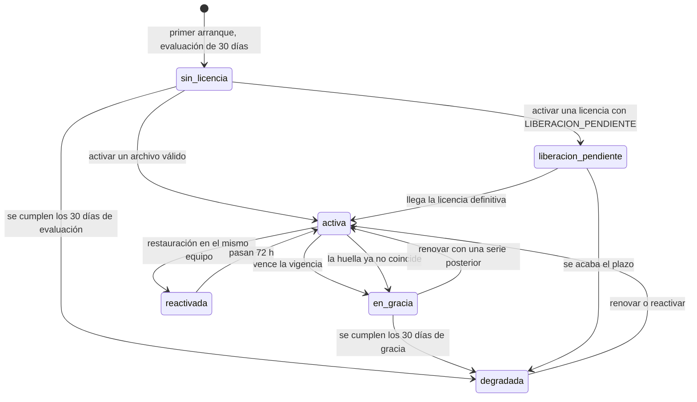

# 15 · Licenciamiento (MOD-018) · Requerimientos

| Campo | Valor |
|---|---|
| Estado | **Especificación** (2026-10-20), escrita mientras se construye el módulo. Dice **qué** se construye y **cómo se comprueba**; el diseño y el contrato exacto de cada ruta los fija quien construye el módulo en `01-diseno.md` y `02-api.md`. Si algo difiere, **manda el código probado** y esta página se corrige (§12 trae la tabla de alineación). |
| Módulo | **MOD-018 · Licensing** (DOM-009) · CAP-110…114 · FUN-188…194 · BR-027 y BR-063 · TST-060 · JRN-001 (paso 3), JRN-019 y JRN-020 · AGG-014 · MSG-063 · PAN-202 · VER-10 |
| Decisiones de partida | [00-prompt.md](00-prompt.md): **P-n** (decididas) y **R-n** (reglas que no se rompen). Aquí se citan; no se reabren sin una razón medible. |
| Documentos hermanos | [impacto-funciones.md](impacto-funciones.md) (qué funciones se pueden perder y por qué) · [guia-usuario-interno.md](guia-usuario-interno.md) (cómo AVACOM emite una licencia) · [guia-usuario-cliente.md](guia-usuario-cliente.md) (cómo el colegio la recibe y la activa) · `01-diseno.md`, `02-api.md`, `03-pruebas.md` (los escribe quien construye el módulo) · `05-emision.md` (manual del emisor) |
| Se apoya en | MOD-001 acceso (permisos y altas), MOD-009 dispositivos (equipos), MOD-019 auditoría (bitácora encadenada), MOD-007 aula (BR-063) y MOD-015 (reloj y huella del equipo: ese módulo no existe todavía, así que se deja detrás de un puerto) |

---

## 0 · Cómo leer este documento

- Cada requisito tiene un identificador: `LIC-D-nn` (modelo de datos), `LIC-B-nn` (backend), `LIC-F-nn` (frontend: Core, OPS y Student), `LIC-E-nn` (el emisor o keygen), `LIC-I-nn` (instalador y operación) y `LIC-N-nn` (invariantes que atraviesan todo).
- Cada fila dice el **requisito**, su **origen** (Documento Maestro o prompt), el **criterio de aceptación** (qué se observa cuando está bien hecho) y la **prueba** (`LT-nn`, definidas en §11).
- **Debe** = obligatorio para cerrar el tramo 0–3. **Debería** = deseable. **(propuesto)** = decisión de esta especificación que el CTO o quien construye pueden cambiar.
- Los valores comerciales (días de evaluación y de gracia, límites, qué módulos se licencian) son **datos provisionales** a la espera del CTO (Q-L1). Nunca están cableados en código.

## 1 · Qué es, y qué no es

> Una **licencia** es un archivo firmado por AVACOM, sellado al equipo maestro, que dice qué puede hacer esa instalación y hasta cuándo, **sin internet**. El **nodo** (backend) la verifica y decide. **OPS** sólo muestra el estado y guía la activación. **Student** no sabe nada de ella (SEC-001). Y **nunca detiene una clase**: avisa antes, degrada después, y siempre con un periodo de gracia por delante.

| Entra (tramo 0–3) | Notas |
|---|---|
| CAP-110 activar con un archivo, sin internet (FUN-188) | Manda la ficha del módulo (archivo); la «activación en línea» de la tabla de capacidades es V1 |
| CAP-111 guardar una copia de la licencia | Un USB con el `.avlic` y una hoja de texto. **No** son claves de datos |
| CAP-112 consultar límites y consumo (FUN-189, FUN-190) | Pantalla en OPS y rutas `estado/` y `consumo/` |
| CAP-113 renovar con un archivo nuevo (FUN-191) · CAP-114 gracia sin cortar la clase (FUN-192, 193, 194) | La máquina de estados completa |
| BR-027 (cupo de identidades) y BR-063 (50/100 concurrentes) **tomados de la licencia** | Hoy BR-063 sale de `settings.py` |
| Permisos, eventos, auditoría, programador, middleware con lista blanca | Backend |
| Pantalla **Licencia** y banner en OPS; textos en Student | Frontend |
| **Emisor interno** (keygen) y su guía | Fuera del nodo y del instalador |

| No entra (se deja preparado) | Por qué |
|---|---|
| Medición de consumo comercial | El Maestro la deja fuera de MOD-018 |
| Activación en línea, revocación remota, paquetes y actualizaciones cifrados con clave de licencia | V1 (P-27): se documenta el contrato, no se construye |
| MOD-020 Notificaciones | No existe: el aviso es banner + bitácora + `/health/` |
| Biblioteca nativa `avacom_lic`, despliegue firmado, identidad de dispositivo con clave en hardware, endurecimiento y prueba adversarial | Fases 4–6 (otras sesiones). Esta especificación deja los puertos |
| TLS en la LAN, llave de firma del APK, Authenticode, MDM | Decisiones de despliegue del CTO (Q-L6, Q-L7, Q-L9) |
| Cualquier cambio dentro de `backend/biblioteca/` | Frontera LMS ↔ Biblioteca (R-12) |

## 2 · Invariantes (valen para todo lo demás)

| ID | Regla | Origen | Cómo se comprueba |
|---|---|---|---|
| LIC-N-01 | **Nunca se detiene una clase.** Ni por vencimiento, ni por cupo, ni por una falla de la licencia. La lista de rutas intocables se **deriva de los `urls.py` reales**, no de una enumeración a mano | R-01 · Maestro H | LT-22: cada ruta intocable responde **igual** con la licencia degradada |
| LIC-N-02 | **Nunca un 4xx de licencia en rutas cuyo cliente guarda una cola** (evaluación, respuestas): el cliente descarta su cola ante un 4xx | R-02 | LT-22 y LT-26: abrir un examen en una tableta nueva con el cupo lleno **funciona** |
| LIC-N-03 | El vencimiento **no borra ni oculta datos académicos** y **ninguna clave de datos** (`AVACOM_LMS_CLAVE_*`, bases, respaldos) se ata a la licencia ni al hardware | R-03 · AGG-014 · DEC-011 | LT-14: con la licencia degradada todas las lecturas académicas siguen igual |
| LIC-N-04 | **Falla operativa, nunca cierre.** Cualquier fallo interno de licenciamiento (excepción, fila corrupta, clave pública ausente, reloj raro) usa el último estado bueno, se registra y se avisa. Nunca un 500 en una ruta de negocio | R-04 | LT-23 |
| LIC-N-05 | `desarrollo` y `pruebas` **no restringen** (las ≈1945 pruebas corren sin licencia) y **ninguna variable de `backend.env` apaga la licencia de un nodo instalado** | R-05 · P-12 | LT-10 y LT-15 |
| LIC-N-06 | El reloj del nodo es la autoridad; ningún dato con valor académico usa el del dispositivo. Licenciamiento mide contra `max(reloj del nodo, marca alta)` | R-06 · INV-017 | LT-28 |
| LIC-N-07 | El camino caliente de cada petición lee el estado **de memoria** (0 consultas SQL). Se escribe sólo en el programador, en eventos y en acciones del administrador | R-07 | LT-24 con `assertNumQueries(0)` |
| LIC-N-08 | **Un escritor por tabla.** `licenciamiento` es dueño de `m18_*` y no lee ni escribe `m01_*` ni `m09_*`: pregunta por el `servicios.py` de cada dueño, y ellos preguntan por el suyo | R-08 · INV-023 | LT-12 (`test_arquitectura.py`) |
| LIC-N-09 | **Catálogos cerrados**: acciones de auditoría, permisos y capacidades existen sólo si están en su catálogo | R-09 | LT-12, LT-30, LT-31 |
| LIC-N-10 | OPS: nada exige teclado ni precisión de ratón; objetivos ≥ 60 px en la pantalla de 86"; confirmar **una** vez; **ningún aviso interrumpe una clase**; sólo `Border`, `Label` y `Button` (un `Path` o `Ellipse` degenerado tumba todos los lienzos Win2D) | R-10 · NFR-044 · S4 | LT-40…LT-44 |
| LIC-N-11 | El estado de la licencia vive en `%ProgramData%\AVACOM\OPS Master\Config\licencia\` y **se conserva** al actualizar y al desinstalar (por omisión) | R-11 | LT-45 |
| LIC-N-12 | **Cero internet** en cualquier ruta del módulo; ningún paquete que descargue algo al ejecutar | R-13 | LT-46 |
| LIC-N-13 | Línea base primero; al terminar **ninguna prueba existente cambia**. Si una falla, el defecto es del licenciamiento | R-14 | LT-35 |
| LIC-N-14 | Kiosco y examen intocables: orden de Lock Task, receptor y `appId` atados a `dpm set-device-owner`, salida de 7 toques, «Salir» ≤ 3 s. **El dispositivo nunca bloquea al alumno** | R-15 | LT-47 |
| LIC-N-15 | Las claves privadas de emisión **no existen** en el repositorio, en el instalador, en logs ni en el chat. El nodo sólo conoce llaves **públicas** | P-03 | LT-48 (prueba de contenido del paquete) |

## 3 · Actores, permisos y qué ve cada uno

| Actor | Permisos de licencia | Qué hace | Qué ve |
|---|---|---|---|
| **Administración** | `license.activate`, `license.renew`, `license.read` (hereda todo permiso nuevo) | Activa, renueva, guarda la copia, libera el equipo | Pantalla **Licencia** completa y el banner |
| **Técnico AVACOM** (instalación y soporte) | `license.activate`, `license.read` | Activa, guarda la copia, libera el equipo; **no** renueva | Pantalla **Licencia** y el banner |
| **Profesor** | ninguno | Nada. Si usa una función apagada ve «no disponible por licencia» | Un mensaje corto y **nunca** datos de la licencia |
| **Reportes** | ninguno | Ídem | Ídem |
| **Alumno** | ninguno | Nada. Sólo puede toparse con `cupo_agotado` al registrar algo **nuevo** | Un texto claro; **nunca** se le bloquea un equipo ya registrado |
| **Sistema** (programador del nodo) | — (actor `sistema`) | Valida, recalcula, avisa, publica eventos | — |
| **AVACOM · emisor** (personal interno) | Fuera del nodo | Firma las licencias con el keygen (§8) | — |

`license.read` es una **extensión técnica propuesta** (como `reports.settings.manage`): estado y consumo, sin datos de personas. El Maestro sólo nombra `license.activate` y `license.renew`.

**Licencia y permiso son cosas distintas** (Maestro · «Licencia y permiso son cosas distintas», VER-10): si la licencia apaga un módulo cuyo permiso el rol **sí** tiene, la respuesta es «no disponible por licencia», no «acceso denegado»; la concesión del permiso se conserva y vuelve a funcionar al renovar sin reasignar roles, y el bloqueo queda como **bloqueo de licencia** en la bitácora. Por eso es un **402** y no un 403 (el middleware de auditoría asienta `acceso.denegado` en todo 403).

## 4 · El ciclo de vida de una licencia



| Estado | Cuándo | Qué cambia para el colegio |
|---|---|---|
| `sin_licencia` | Desde el primer arranque con esta versión; **30 días** de evaluación (P-14) | Todo habilitado con los límites de evaluación. Aviso cuando quedan ≤ 7 días |
| `activa` | Dentro de la vigencia y con la huella de este equipo | Lo que dice la licencia. Avisos 30/14/7/3/1 días antes de vencer |
| `reactivada` | Justo después de recuperar la licencia tras una restauración (FUN-194) | Igual que activa; se muestra 72 h |
| `en_gracia` | Venció, o este equipo ya no es el de la licencia | **No se pierde nada**; aviso visible. Dura `gracia_dias` |
| `liberacion_pendiente` | Licencia emitida mientras se libera el equipo anterior (JRN-020, MSG-063) | Opera por el plazo que trae la propia licencia |
| `degradada` | Se acabó la gracia (o la evaluación): degrada **en ese instante**, sin día de más (la gracia son 30 días corridos exactos, Q-L16) | Se apagan **sólo** las capacidades licenciables. Clase, examen, estudio, notas y bitácora siguen |

Banderas **ortogonales** (se suman al estado, no lo reemplazan): `reloj_sospechoso` (reloj atrasado), `reloj_adelantado` (fecha adelantada que el nodo **no acepta**, Q-L13), `huella_parcial`, `integridad_alterada`. Ninguna quita funciones: sólo avisan; la fecha adelantada es un **error** que no se guarda, no degrada y no se quita hasta que la fecha concuerda.

**El estado no se guarda**: sale de una función pura `calcular(contexto, política)` con el tiempo y los hechos del historial. Lo que se guarda es el historial de sólo inserción y los eventos.


---

# PARTE 1 · MODELO DE DATOS

## 5 · Los datos del módulo

### 5.1 · Tres archivos, una sola envoltura

| Archivo | Quién lo escribe y firma | Para qué | Variante de texto |
|---|---|---|---|
| `.avreq` **solicitud** | El **nodo**, con su propia llave | Pedirle a AVACOM una licencia sellada a este equipo | `AVQ1.` + base64url |
| `.avlic` **licencia** | **AVACOM** (emisor), con la llave de emisión | Decir qué puede hacer esta instalación y hasta cuándo | `AVL1.` + base64url |
| `.avrel` **liberación** | El **nodo viejo**, con su propia llave | Probar que este equipo ya no usará la licencia (cambio de equipo) | `AVR1.` + base64url |

```
magic(4) · versión(u16) · largo del kid(u8) · kid · [ etiqueta(u16) · largo(u16) · valor ]… · firma(64)
```

- Todo va en orden de red (big endian). `magic`: `AVLC` licencia, `AVRQ` solicitud, `AVRL` liberación. **Versión = 1**; ni una menor (degradación) ni una mayor (no se entiende).
- La **firma Ed25519** cubre **todo lo anterior a ella** (magic, versión y `kid` incluidos). El algoritmo está **fijado**: no existe un campo `alg` que negociar.
- `kid`: 1–64 caracteres `[a-z0-9._-]` en el formato. En una **licencia** elige entre las llaves públicas que el nodo conoce (`prod-2026-1`; el cargador del nodo acepta nombres de hasta 32 caracteres, y es el límite que respeta el emisor). En una **solicitud** o **liberación** el `kid` **es la llave pública del nodo** en hexadecimal (64 caracteres) y se verifica contra sí misma: demuestra que quien pide posee esa llave y que nadie tocó la huella en el camino.
- Las etiquetas van en orden **estrictamente ascendente**. El bit 15 marca una etiqueta **crítica**: quien no la entiende **rechaza** el archivo; una no crítica desconocida se ignora.
- Topes: archivo ≤ 16 KiB (una licencia real mide < 600 bytes), valor ≤ 4096, ≤ 32 etiquetas.
- La variante de texto es **estricta**: sólo la forma canónica (sin espacios, sin relleno, sin bits sobrantes). Una variante «equivalente» no es otro texto válido.

**Licencia (`AVLC`)**

| Etiqueta | Campo | Tipo | Crítica | Significado |
|---:|---|---|:---:|---|
| 1 | `id_licencia` | 16 bytes (UUID) | sí | Identifica la licencia a lo largo de las renovaciones |
| 2 | `serie` | u32 ≥ 1 | sí | Sube con cada archivo nuevo de la misma licencia: no se puede volver a uno anterior |
| 3 | `aula` | texto UTF-8 ≤ 120 | no | Sólo informativo: **ninguna decisión se toma con él** |
| 4 | `emitida` | u64 · ms UTC | sí | Cuándo la firmó AVACOM |
| 5 | `desde` | u64 · ms UTC | sí | Primer instante de vigencia |
| 6 | `vence` | u64 · ms UTC | sí | Fin de la vigencia; empieza la gracia |
| 7 | `gracia_dias` | u16 ≤ 365 | sí | Días de gracia tras vencer (y tras un cambio de equipo) |
| 8 | `limites` | 4 × u32 | sí | equipos · usuarios · concurrentes normal · concurrentes pico (`0xFFFFFFFF` = sin tope; normal ≤ pico) |
| 9 | `capacidades` | lista de códigos ASCII | sí | Módulos licenciables que se habilitan; `*` = todos. En orden y sin repetir (≤ 64) |
| 10 | `huella` | `k`(u8) `n`(u8) + n × (factor u8 + hash de 32 bytes) | sí | El equipo al que se sella: deben coincidir `k` de `n` factores |
| 11 | `tipo` | u8 | sí | 1 producción · 2 evaluación · 3 desarrollo |
| 12 | `banderas` | u32 + u16 | sí | Bit 0 = `LIBERACION_PENDIENTE`; días de liberación pendiente (≤ 365, sólo con la bandera) |
| 13 | `hash_clave_nodo` | 32 bytes | no | SHA-256 de la llave pública del nodo para el que se emitió (el emisor lo coteja en una liberación) |

Reglas de forma: `0 < desde < vence`, vigencia ≤ 25 años, `serie ≥ 1`, `gracia ≤ 365`, `concurrentes_normal ≤ concurrentes_pico`, códigos de capacidad `[a-z0-9_*]{1,24}`.

**Solicitud (`AVRQ`)**: `1 nonce` (16 B) · `2 versión del nodo` (≤ 32 B, no crítica) · `3 creada` (u64 ms) · `4 nivel` (1 hardware · 2 instalación) · `5 huella` (igual que en la licencia) · `6 llave pública del nodo` (32 B) · `7 licencia vigente` (16 B, no crítica) · `8 aula` (≤ 480 B, no crítica). **Sin identificadores crudos del equipo, sin datos de personas.**

**Liberación (`AVRL`)**: `1 id de la licencia` · `2 serie` · `3 liberada` (u64 ms) · `4 nonce` · `5 llave pública del nodo`; todas críticas.

### 5.2 · La huella del equipo maestro

| Factor | Qué es | Cómo se lee |
|---:|---|---|
| 1 | `MachineGuid` de Windows | Registro |
| 2 | UUID de SMBIOS | `GetSystemFirmwareTable('RSMB')` |
| 3 | Serie de la placa | SMBIOS tipo 2 |
| 4 | Serie del chasis | SMBIOS tipo 3 |
| 5 | `ProcessorId` | SMBIOS tipo 4. **Reservado: no sella** (D-3 de la otra sesión): es el CPUID del *modelo* del procesador, igual en todos los equipos del mismo modelo |
| 6 | **Secreto de instalación** | Aleatorio del primer arranque, protegido con DPAPI de máquina. Sólo se usa si **la huella no alcanza nivel `hardware`** |

- Cada factor viaja como `HMAC-SHA256(clave de producto, "factor:valor normalizado")`: nunca el identificador crudo. La clave de producto **no es un secreto**; evita que los identificadores sean «buscables» en una solicitud.
- Se **descartan los valores de relleno** que traen las placas OEM de los paneles («To be filled by O.E.M.», «Default string», ceros, `FFFF…`, «System Serial Number»…). En la máquina de desarrollo medida en la Fase 0, las series de placa, de chasis, de BIOS y de sistema eran «Default string»: **no es un caso raro**.
- Coincidencia **k de n entre los factores de unidad** (1 a 4): **2 de 2, 2 de 3 o 3 de 4**. Con tres o más sobrevive al cambio de un disco o de una tarjeta; un disco clonado en otra placa no pasa. Con sólo dos (disco y placa) no se distingue un clon de una placa cambiada, así que se exigen los dos.
- El nivel es **`hardware`** si hay al menos dos factores de unidad válidos y alguno ligado a la placa (UUID de SMBIOS, serie de la placa o del chasis); si no, **`instalacion`** (visible en pantalla; más débil: un disco clonado trae el secreto). **Nunca se impide activar por tener hardware pobre.**
- La **deriva de huella es un modo de fallo esperado**: se resuelve reactivando o liberando, jamás con un bloqueo.

### 5.3 · Llaves

| Llave | Dónde vive | Quién la usa |
|---|---|---|
| **Emisión** (privada, Ed25519) | **Fuera** del repositorio y de todo equipo de cliente (HSM, YubiKey o equipo sin red). Nunca en CI, logs ni chat | El emisor (§8) |
| **Emisión** (públicas, ≥ 2) | `backend/licenciamiento/claves/produccion.json`: `{"version": 1, "claves": [{"kid", "publica", "estado": "vigente" \| "siguiente" \| "retirada"}]}` (la vigente y la siguiente, para rotar; las `retirada` se ignoran). **Hoy está vacío**: la ceremonia es del CTO | El nodo, para verificar `.avlic` |
| **Desarrollo** `dev-1`, `dev-2` | Derivadas de una semilla **pública**, sólo en `licenciamiento.tests`. El nodo las acepta **únicamente** si el entorno es de desarrollo o de pruebas | Las pruebas |
| **Nodo** (par Ed25519 propio) | La privada, **protegida con DPAPI de máquina** en la carpeta de estado, nunca en la base; la pública, en `m18_nodo` y como `kid` de cada `.avreq` y `.avrel` | El nodo, para firmar sus solicitudes y liberaciones |

### 5.4 · El estado: una función pura

`calcular(contexto, política) → Estado`. No lee ningún reloj ni ninguna base: recibe los hechos.

| Entrada (`Contexto`) | Qué es |
|---|---|
| `licencia` | La licencia vigente verificada, o nada |
| `ahora` | El instante **confiable**: `max(reloj del nodo, marca alta)`; con una fecha adelantada que no se acepta, el que el aula lleva (nunca el del salto) |
| `instalada_en` | Primer arranque con licenciamiento (empieza la evaluación) |
| `coincidencia` | Huella de la licencia contra la de este equipo (`k`, cuántos factores, `ok`, `parcial`) |
| `licencia_instalada_en` · `huella_distinta_desde` · `reactivada_en` | Hitos del historial |
| `reloj_retroceso` · `reloj_adelanto_ms` | Señales del reloj: el reloj atrasado, y cuánto está adelantada la fecha del equipo cuando el nodo no la acepta (0 si no lo está; Q-L13) |
| `integridad_alterada` | Señal de integridad (Fase 4) |

| Salida (`Estado`) | Qué es |
|---|---|
| `estado`, `motivo` | Uno de los seis estados y el «por qué» (`evaluacion`, `vigente`, `vencida`, `huella_distinta`, `liberacion_pendiente`, `reactivada`…) |
| `hasta`, `dias_restantes` | Próximo hito (fin de vigencia, de gracia, de liberación o de evaluación) y días **completos** que faltan (se redondea hacia arriba, nunca negativos) |
| `banderas` | Las ortogonales |
| `capacidades` | Las licenciables habilitadas **ahora** |
| `limites`, `tipo`, `licencia_id`, `serie` | De la licencia (o los de evaluación) |

Reglas, en orden:

1. **Sin licencia, o `ahora < desde`**: ventana de evaluación desde `instalada_en`. Con las licenciables habilitadas y los límites de evaluación. Al cumplirse los 30 días: `degradada` (motivo `evaluacion_vencida`), en ese instante.
2. **La huella no coincide** (≥ k factores): `en_gracia` (motivo `huella_distinta`) desde la primera vez que se observó, por `gracia_dias`; después, `degradada`.
3. **Vigente** (`ahora ≤ vence`): `liberacion_pendiente` si lo declara la licencia (plazo = `liberacion_dias` desde que se instaló esa serie, sin pasar de `vence`); `reactivada` si pasaron ≤ 72 h desde una reactivación; si no, `activa`.
4. **Vencida**: `en_gracia` hasta `vence + gracia_dias`; después, `degradada`.
5. **Degradar ocurre en el instante en que se acaba el plazo**: la gracia son 30 días corridos exactos (Q-L16), sin histéresis (`histeresis_ms = 0`: el instante confiable jamás baja, así que el estado no puede oscilar en el borde). **Retroceder el reloj no aplaza nada ni lo congela**: el vencimiento se mide contra el instante confiable, que nunca baja de la marca alta **y avanza con el reloj monótono** aunque el de pared esté atrasado (LIC-B-25: una fecha atrasada, o una pila de BIOS agotada, no alarga una licencia). **Adelantar la fecha tampoco la mueve** (Q-L13, LIC-B-27): un salto hacia adelante mayor que el umbral dentro de un proceso en marcha **no se acepta ni se guarda**, la licencia sigue contando el tiempo real, no degrada por él y el nodo avisa con un error hasta que la fecha concuerde; no hay aplazamiento de 72 h.

### 5.5 · La política es un dato (decidido por el CTO el 2026-10-20: gracia, tamaño máximo y fecha adelantada; lo demás, provisional)

| Parámetro | Valor provisional | Para qué |
|---|---|---|
| Evaluación | 30 días | Ventana de un nodo sin licencia (recién instalado o actualizado) |
| Avisos | 30 · 14 · 7 · 3 · 1 días | Un aviso al cruzar cada umbral antes de vencer |
| Aviso de evaluación | ≤ 7 días | Cuándo empieza a avisar la evaluación |
| Tolerancia de retroceso | 5 min | Ajustes de hora normales |
| Salto hacia adelante (fecha adelantada) | 7 días | Entre dos lecturas del **mismo proceso**; un nodo apagado diez días **no** es un salto. **Decidido (Q-L13):** no se acepta, no se guarda y no degrada |
| La fecha «concuerda» | 1 día | El reloj de pared a menos de esto del instante confiable: el error de la fecha adelantada se quita solo |
| Histéresis | 0 | **Decidido (Q-L16):** la gracia son 30 días corridos exactos y degrada en el instante en que se cumplen |
| Gracia (la trae cada licencia) | 30 días corridos exactos | **Decidido (Q-L16):** el emisor no firma otra |
| Huella `k` | 2 de 2 · 2 de 3 · 3 de 4 | Entre los factores de unidad (`k_para`) |
| Ventana «reactivada» | 72 h | |
| Aviso de cupo | 90 % | |
| Límites de evaluación | 60 equipos · 1200 usuarios · 50/100 concurrentes | **Decidido (Q-L1):** el tamaño máximo de un aula, también sin licencia. El cupo sólo cuenta al crear: lo que ya existe sigue funcionando |
| Tamaño máximo de un aula | 60 equipos · 1200 usuarios | **Decidido (Q-L1):** en una misma pantalla; ninguna licencia que emita AVACOM pasa de ahí, ni «sin tope» (`planes/reglas.json`) |

Lo que decide **cada licencia** (vigencia, gracia, límites, módulos) viaja **dentro** de ella; la política sólo cubre lo que una licencia no puede decir.

### 5.6 · Tablas `m18_*` (**como las construyó el nodo**, `backend/licenciamiento/models.py`)

Esta especificación proponía una tabla `m18_nodo`, una `m18_solicitud` y una `m18_aviso`; la implementación las resolvió de otro modo (lo que manda es el código probado):

| Tabla | Para qué | Clase | Notas |
|---|---|---|---|
| `m18_licencia` | **Historial de sólo inserción** de cada hecho (`activada`, `renovada`, `reactivada`, `liberada`) | Propia (perderla es perder la historia) | Guarda el **archivo firmado completo** (nulo en una liberación). **La fila no es de confianza**: el nodo **vuelve a verificar** la firma con las llaves de ahora; una fila que ya no pasa se toma como ausente y deja una observación `firma_invalida`. Trigger contra `UPDATE` |
| `m18_observacion` | Hechos observados que **explican** el estado: primera vez que la huella no coincidió y cuándo volvió, un reloj que retrocedió o saltó, la confirmación del administrador, un ancla alterada, una firma inválida | Propia | Sólo inserción, con cifras y sin contenido. **Sustituye a las columnas de `m18_nodo`** (`huella_distinta_desde`, `salto_adelante_desde`) y a `m18_aviso` |
| `m18_marca_alta` | El instante más alto que el nodo ha visto | Propia | Un trigger **impide bajarla** |
| `m18_instalacion` | Una fila: cuándo empezó la ventana de evaluación | Propia | Además está en el ancla de fuera de la base: si la base trae una fecha más tardía (restauró un respaldo viejo) vale la menor |
| `m18_consumo` | El último conteo de equipos y usuarios (FUN-190) | **Derivada** (se puede borrar) | Se guarda una vez por hora, con su evento |
| `m18_evento_salida` | Cola de salida de los eventos `licencia.*.v1` | Propia | **`clave` única**: escribir el mismo evento dos veces no hace nada (idempotente). Es lo que hace que un aviso (30/14/7/3/1) y una transición salgan **una sola vez** |

Las **solicitudes** no se guardan: dejan un asiento `licencia.solicitud_generada` (nivel, `k`, cuántos factores y el hash del archivo). No hay tabla de «estado actual» (§5.4). Ninguna tabla `m18_*` tiene claves foráneas fuera del módulo.

**Anclas fuera de la base** (que un respaldo restaurado no rebobina): el archivo `ancla-reloj.json` en la carpeta de estado (la marca alta y el inicio de la evaluación, con una **verificación HMAC** derivada del secreto de instalación: si alguien lo edita no cuenta y se avisa como integridad alterada), la clave del registro `HKLM\SOFTWARE\AVACOM\OPS Master\Licencia` (sólo en producción) y la **fecha del último asiento de la bitácora encadenada**. `marca alta = max(base, anclas, última bitácora)`; el vencimiento se mide contra ella.

**Carpeta de estado** (`%ProgramData%\AVACOM\OPS Master\Config\licencia\`, R-11; en producción **siempre** esa: una variable de entorno no puede moverla): `actual.avlic` (copia de la licencia vigente, el espejo para reactivar tras restaurar una base vieja), `liberadas.json` (las licencias que este nodo liberó: una base restaurada no las resucita), `ancla-reloj.json`, `instalacion.bin` (el secreto de instalación) y `nodo.key` (la llave Ed25519 del nodo), ambos con **DPAPI de máquina**. Un secreto o una llave que **no se pueden abrir** (otro Windows, un disco clonado) se **ponen en cuarentena** (`<nombre>.ilegible-<fecha>`, se conservan los últimos 5) en vez de reemplazarse en silencio.

### 5.7 · Lo que **no** se guarda

Identificadores crudos del equipo (sólo hashes con clave de producto) · claves privadas de emisión · datos de personas · el contenido de la licencia en la bitácora (sólo ids, serie, resultado y hash SHA-256) · ninguna clave de datos del colegio atada a la licencia.

## 5.8 · Requisitos del modelo de datos

| ID | Requisito | Origen | Criterio de aceptación | Prueba |
|---|---|---|---|---|
| LIC-D-01 | **Debe** haber tres archivos con la envoltura de §5.1, firmados con Ed25519 sobre todo lo anterior, con algoritmo fijado | P-02 | Un archivo con **un solo bit** alterado en cualquier posición se rechaza; una versión ≠ 1 se rechaza | LT-01 · LT-02 |
| LIC-D-02 | **Debe** verificar en orden: cabecera con topes → firma → campos | P-02 | Un archivo con firma inválida y campos absurdos se rechaza por `firma_invalida` (no por el campo); con firma válida y un campo fuera de rango, por `campo_invalido` | LT-02 |
| LIC-D-03 | **Debe** haber una **sola forma canónica** de cada archivo | P-02 | Etiquetas desordenadas o repetidas, capacidades sin orden, factores sin orden y texto con relleno o espacios se rechazan | LT-03 |
| LIC-D-04 | **Debe** distinguir etiquetas críticas y no críticas | P-02 | Una crítica desconocida rechaza (`etiqueta_critica_desconocida`); una no crítica desconocida se ignora; el bit crítico de una etiqueta conocida debe ser el declarado | LT-04 |
| LIC-D-05 | **Debe** respetar los topes (16 KiB, 4096, 32 etiquetas, kid ≤ 64) | P-02 | Un archivo mayor o con más etiquetas se rechaza sin leerlo entero | LT-02 |
| LIC-D-06 | **Debe** haber huella multifactor tolerante (k de n entre los factores de unidad: 2 de 2, 2 de 3, 3 de 4) con descarte de valores de relleno y nivel `instalacion` cuando no alcanza el nivel `hardware` | P-04 · D-3 | Con 4 factores, 3 coincidencias dan `activa` y 2 dan `en_gracia`; los factores de relleno no cuentan; el `ProcessorId` no sella; un equipo sin factores útiles **puede** activar (nivel `instalacion`) | LT-05 |
| LIC-D-07 | **Debe** no llevar identificadores crudos ni datos de personas en solicitudes, asientos, eventos ni logs | P-04 · P-16 | Un recorrido por los archivos y la bitácora no encuentra el `MachineGuid`, el UUID de SMBIOS ni una serie en claro | LT-06 |
| LIC-D-08 | **Debe** calcular el estado con una función pura y **no guardarlo** | P-05 | Borrar la memoria y las filas derivadas devuelve el mismo estado; la tabla de estados × reloj × gracia está completa | LT-07 |
| LIC-D-09 | **Debe** guardar el historial de sólo inserción y **volver a verificar la firma al arrancar** | P-05 · R-04 | Un `UPDATE` o `DELETE` sobre `m18_licencia` falla; una fila con el archivo alterado se ignora y deja asiento | LT-08 |
| LIC-D-10 | **Debe** tener marca alta monótona con trigger y anclas externas | P-06 | El trigger impide bajarla; restaurar una base vieja no rebobina el vencimiento; retroceder el reloj no alarga ni congela la licencia (LIC-B-25) | LT-09 · LT-28 |
| LIC-D-11 | **Debe** guardar la política como dato; ninguna variable de entorno puede, en un nodo instalado, acortar la evaluación, ampliar límites ni apagar la licencia | P-13 · P-12 | Con `AVACOM_LMS_ENTORNO=pruebas` en `backend.env` de un layout de producción el nodo **sigue evaluando** la licencia | LT-10 · LT-15 |
| LIC-D-12 | **Debe** proteger la llave privada del nodo (DPAPI de máquina) y no guardarla en la base | P-04 | La base no contiene la llave privada; sin la carpeta de estado no se puede firmar una solicitud | LT-11 |
| LIC-D-13 | **Debe** respetar un escritor por tabla y no tener claves foráneas fuera de `m18_*` | R-08 | `test_arquitectura.py`: dominio y aplicación sin Django; sin FK ajenas; sin lectura ni escritura de `m01_*`/`m09_*` | LT-12 |
| LIC-D-14 | **Debe** publicar sus eventos por una cola propia, idempotentes por (tipo, licencia, serie, hito) | P-16 | Repetir un cálculo no duplica eventos | LT-13 |
| LIC-D-15 | **Debe** no atar datos académicos ni sus claves a la licencia | R-03 · AGG-014 | Con la licencia degradada todas las lecturas académicas devuelven lo mismo que con la licencia activa | LT-14 |
| LIC-D-16 | **Debería** no podar `m18_licencia` ni `m18_nodo` | AGG-014 | Ninguna rutina los borra | LT-12 |


---

# PARTE 2 · BACKEND (endpoints, reglas y enganches)

## 6 · El backend del módulo

### 6.1 · Arquitectura

Hexagonal, igual que `gradebook/`, `search/` y `reporting/`:

```
backend/licenciamiento/
├── models.py                 m18_* (§5.6)
├── servicios.py              interfaz pública para los OTROS módulos (cupo, capacidades, estado)
├── dominio/                  reglas puras; NO importan Django ni DRF
│   ├── tlv.py · firma.py · licencia.py · solicitud.py     los tres archivos (§5.1)
│   ├── huella.py · smbios.py                               la huella (§5.2)
│   ├── estado.py · politica.py · reloj.py · cupo.py        estado, política, reloj y cupo (§5.4, 5.5)
│   ├── rutas.py                                            lista blanca y tabla de rutas licenciables
│   ├── entorno.py · catalogos.py · errores.py              entorno, catálogos cerrados y errores
├── aplicacion/               casos de uso (§6.3); NO importan Django ni DRF
├── infraestructura/          ORM, huella de Windows, anclas, llaves, adaptadores de los dueños, programador
├── interfaces/               vistas DRF, rutas `/api/licencia/` y el middleware
├── claves/                   ranuras de llaves públicas (producción; la de desarrollo no viaja)
└── tests/                    dominio, arquitectura, mutaciones, API, middleware; emisor de PRUEBAS
```

### 6.2 · Puertos y adaptadores (R-05)

La licencia entra por un **puerto** con dos adaptadores, igual que el resto de los módulos:

| Puerto | Producción (`produccion`) | Desarrollo y pruebas |
|---|---|---|
| Licencia vigente (estado en memoria) | `LicenciaFirmada` | `LicenciaIlimitada`: **nunca restringe** |
| Reloj | Reloj del nodo + marca alta | Reloj falso inyectable |
| Fuente de huella | Windows: registro, SMBIOS, secreto de instalación | Falsa |
| Llaves públicas | Ranuras `claves/` (producción) | Más `dev-1` y `dev-2`, **sólo** aquí |
| Consumo | `acceso.servicios` y `device_manager.servicios` | Falsos |
| Auditoría y cola | `audit.servicios` y `m18_evento_salida` | |

**Qué es producción** (P-12): lo es **cualquiera** de: existe el marcador de canal `.avacom-canal` junto al código; el código corre bajo `Program Files`; o `AVACOM_LMS_ENTORNO=instalado` (esa variable sólo puede **añadir** protección). Sólo si **ninguna** se cumple **y** hay un `.git` en un ancestro es desarrollo (o pruebas, si el comando es `manage.py test`). Ante la duda, se licencia. Un administrador que copie el backend fuera de `Program Files`, borre el marcador y fabrique un `.git` lo evade: es A4, se documenta y no se promete impedirlo.

### 6.3 · Casos de uso

| Caso de uso | CAP · FUN | Quién | Permiso | Precondición | Efecto | Evento | Asiento |
|---|---|---|---|---|---|---|---|
| **ValidarAlArrancar** | FUN-189 | Sistema | — | Hay licencia instalada, o se abre la ventana de evaluación | Re-verifica la firma, recalcula y fija el estado en memoria | `licencia.validada.v1` | Sólo si cambia el estado |
| **GenerarSolicitud** | CAP-110 | Técnico · Admin | `license.activate` | — | `.avreq` firmado con la llave del nodo (huella hasheada, nonce, nivel) | — | `licencia.solicitud_generada` |
| **InspeccionarArchivo** | apoyo | Técnico · Admin | `license.activate` | — | Verifica y **resume** sin instalar nada (qué acción tomaría) | — | `licencia.firma_invalida` si no verifica |
| **ActivarLicencia** | CAP-110 · FUN-188 | Técnico · Admin | `license.activate` | Archivo válido; la huella coincide (o trae `LIBERACION_PENDIENTE`); no hay otra licencia **distinta** instalada (con una licencia sana no se cambia por otra: primero se libera este equipo). **También es el traslado** (D-10): la misma licencia, la serie siguiente y **otra huella** —el equipo nuevo que restauró la base del viejo— la activa el técnico | Historial + estado en memoria + copia en la carpeta de estado | `licencia.activada.v1` | `licencia.activada` |
| **RenovarLicencia** | CAP-113 · FUN-191 | Admin | `license.renew` | Misma `id_licencia`, `serie` **mayor** y **la misma huella**: es renovación vengan los bytes por «renovar» o por «activar» (por «activar» sólo la administración la acepta) | Ídem | `licencia.renovada.v1` | `licencia.renovada` |
| **LiberarEquipo** | JRN-020 | Técnico · Admin | `license.activate` | Hay licencia instalada | `.avrel` firmado con la llave del nodo; este equipo **vuelve a `sin_licencia`** (así lo construyó el nodo): la clase no se corta —el núcleo nunca se degrada— y los módulos licenciables se apagan cuando termine la evaluación. Se puede deshacer volviendo a activar el mismo archivo | `licencia.liberada.v1` (extensión) | `licencia.liberada` |
| **ReactivarTrasRestauracion** | FUN-194 · TST-060 | Sistema (arranque) | actor `sistema` | La copia de la carpeta de estado verifica y su huella coincide, y la base no la tiene o tiene una serie menor | Inserta `reactivada` | `licencia.reactivada.v1` | `licencia.reactivada` |
| **EvaluarEstado** (programador) | FUN-192 · FUN-193 | Sistema | — | Temporizador | Transiciones a gracia y a degradada | `licencia.periodo_gracia_iniciado.v1` · `licencia.funciones_degradadas.v1` | `licencia.gracia_iniciada` · `licencia.degradada` |
| **AvisarEscalonado** | CAP-114 | Sistema | — | Se cruzó 30/14/7/3/1 | Un aviso por umbral (`m18_aviso`) | `licencia.aviso_emitido.v1` (extensión) | — |
| **CalcularConsumo** | FUN-190 | Sistema | — | La licencia declara límites | Consumo frente a los dueños | `licencia.consumo_calculado.v1` | — |
| **ConfirmarReloj** | P-06 · Q-L13 | Técnico · Admin | `license.activate` | Hay una fecha adelantada que el nodo no aceptó (o un reloj atrasado) | Acepta la fecha del equipo como la correcta: cierra el episodio y **sólo entonces** el aula la guarda como marca alta | — | `licencia.reloj_confirmado` (extensión) |
| **EntregarCopia** | CAP-111 | Técnico · Admin | `license.read` | Licencia instalada | El archivo firmado + una hoja de entrega | — | — (lectura) |
| **AplicarCupo** (servicio) | BR-027 · BR-063 | `acceso` · `device_manager` | — | Alta **nueva** | Admite o responde `cupo_agotado` | — | `licencia.bloqueo_aplicado` (agregado) |

Todo caso de uso que cambia algo lo hace en **una transacción** que incluye el historial, el asiento y el evento: si la bitácora falla, la operación se revierte (503 `bitacora_no_disponible`). Lo único que **no** puede tumbar una petición es el **asiento de un bloqueo** (§6.6).

### 6.4 · Rutas `/api/licencia/` (contrato requerido)

Los cuerpos exactos y los errores **reales capturados** quedan en `02-api.md`. Todas son **intocables** (sin la licencia no se puede renovar). Los errores tienen la forma común `{"detail", "codigo", …}`.

| Método y ruta | Permiso | Para qué |
|---|---|---|
| `GET estado/` | `license.read` | Estado, motivo, banderas, próximo hito, días, licencia (sin hashes), límites, capacidades, huella (nivel y cuántos factores), avisos |
| `GET consumo/` | `license.read` | Equipos y usuarios en uso frente al límite, concurrentes y bloqueos de las últimas 24 h (FUN-190) |
| `GET capacidades/` | **cualquier sesión** | Qué módulos están habilitados **ahora** y el estado; **sin detalles** (para que las pantallas pinten «no disponible» sin llamar a lo apagado) |
| `POST solicitud/` | `license.activate` | Genera el `.avreq`: archivo en base64, variante `AVQ1.`, nombre sugerido, SHA-256, nivel y cuántos factores |
| `POST inspeccionar/` | `license.activate` | Cuerpo `{archivo_b64}` o `{texto}`. Verifica y devuelve el **resumen** (aula, tipo, vigencia, gracia, límites, capacidades, `coincide`, serie, qué acción se tomaría y advertencias). **No cambia nada** |
| `POST activar/` | `license.activate` | Cuerpo `{archivo_b64, confirmar: true}` o `{texto, confirmar: true}`. Instala la primera licencia, la reactiva o **traslada** (misma licencia, serie posterior, otra huella); con la misma huella y una serie posterior es una renovación y pide `license.renew` |
| `POST renovar/` | `license.renew` | Igual, exige la misma licencia y una serie posterior |
| `POST liberar/` | `license.activate` | Cuerpo `{confirmar: true}`. Devuelve el `.avrel` (base64 y `AVR1.`) |
| `POST reloj/confirmar/` | `license.activate` | Confirma que el cambio de fecha es correcto |
| `GET copia/` | `license.read` | La licencia vigente (firmada) y una hoja de entrega en texto, para guardarla (CAP-111) |
| `GET /health/` | — | Gana un campo **aditivo** `licencia: {estado, dias_restantes}`; sólo se **añade**, nunca se cambia lo que ya devuelve |

Ejemplo ilustrativo de `GET estado/` (la forma exacta la fija `02-api.md`):

```json
{
  "estado": "en_gracia", "motivo": "vencida", "banderas": [],
  "hasta": 1793000000000, "dias_restantes": 12, "servidor_en": 1790000000000,
  "licencia": {"id": "a7a7a7a7-0001-4000-8000-000000000001", "serie": 2, "aula": "Colegio de ejemplo",
               "tipo": "produccion", "desde": 1761000000000, "vence": 1789000000000, "gracia_dias": 30, "kid": "prod-2026-1"},
  "limites": {"equipos": 60, "usuarios": 1200, "concurrentes_normal": 50, "concurrentes_pico": 100},
  "capacidades": {"reportes": true, "busqueda": true, "importacion": true, "administracion_avanzada": true},
  "huella": {"nivel": "hardware", "k": 3, "en_licencia": 4, "coinciden": 4},
  "avisos": [{"codigo": "gracia", "motivo": "vencida", "dias": 12}]
}
```

### 6.5 · Errores

| HTTP | `codigo` | Cuándo | Extras |
|---:|---|---|---|
| 400 | `datos_invalidos` | Cuerpo mal formado | `errores` |
| 400 | `licencia_invalida` | El archivo no verifica o no es una licencia | `motivo`: `demasiado_grande` · `demasiado_corta` · `formato` · `texto` · `version_no_soportada` · `kid_desconocido` · `firma_invalida` · `etiqueta_critica_desconocida` · `campo_faltante` · `campo_invalido` · `solicitud_ajena` · `serie_no_posterior` · `otra_licencia` · `sin_licencia_instalada` · `tipo_no_admitido` (parte del contrato: **no se renombran**) |
| 403 | `sin_permiso` | Falta `license.*` | `permiso` |
| 404 | `no_encontrado` | No existe lo pedido | |
| 409 | `huella_no_coincide` | La licencia es de **otro equipo** (se rechaza al activar; la gracia es para una licencia ya instalada cuyo equipo cambió) | |
| 409 | `conflicto` | Choca con el estado actual | |
| **402** | `no_disponible_por_licencia` | Un módulo apagado | `capacidad` |
| **402** | `cupo_agotado` | Alta **nueva** sobre el cupo | `tipo` (`equipos` · `usuarios`), `limite`, `en_uso` |
| 503 | `bitacora_no_disponible` | No se pudo asentar una acción del administrador | |

**402, no 403**, y **nunca** en rutas con cola (LIC-N-02).

### 6.6 · El middleware `LicenciaMiddleware`

| Requisito | Detalle |
|---|---|
| Lugar | `MIDDLEWARE`: **dentro** de `CorrelacionMiddleware` (para que el 402 lleve su `corr` y quede en el log) y **después** de `PaseDeMediosMiddleware` (que reescribe `/api/m/<pase>/…` a la ruta normal) |
| Decisión | `rutas.capacidad_de(método, ruta)`: **primero** la lista blanca (intocables), luego la tabla «método + ruta → capacidad». Lo que no aparece, pasa. `HEAD` se trata como `GET` |
| Estado | Se lee **de memoria**: 0 consultas SQL por petición |
| Respuesta | `402` con `{"detail", "codigo": "no_disponible_por_licencia", "capacidad": …}` y asiento `licencia.bloqueo_aplicado` **agregado** (uno por actor, capacidad y hora) y de **mejor esfuerzo**: si el asiento falla, el 402 sale igual |
| Falla | `try/except` total que **deja pasar** y registra (R-04) |
| Alcance | El WebSocket no pasa por él y no se bloquea |

**Tabla de rutas licenciables (propuesta de esta especificación; la lista blanca se deriva de los `urls.py`)**:

| Capacidad | Rutas | Notas |
|---|---|---|
| `reportes` | `/api/reportes/…` **salvo** `boletines/` y `exportaciones/` | **H-03**: esas dos son la única vía para exportar calificaciones; Q-L12 y R-03 dicen «no limitar» por omisión. Si el CTO decide lo contrario, entran aquí |
| `busqueda` | `/api/search/…` | |
| `importacion` | `POST /api/acceso/usuarios/importar/` | El alta de uno en uno se rige por el **cupo**, no por la capacidad |
| `administracion_avanzada` | `POST /api/acceso/roles/` · `POST /api/gradebook/escalas/` (y `adoptar/`, `<id>/versiones/`) · `POST /api/gradebook/derivados/reconstruir/` | **H-02**: **no** incluye `PUT /api/acceso/politicas/…` (los interruptores de registro propio y de visitantes **cierran puertas** y no se licencian) |

### 6.7 · Los cupos (BR-027 y BR-063): bloquear lo nuevo, nunca lo existente

| Qué | Dónde se aplica | Regla |
|---|---|---|
| **Usuarios nuevos** | Un solo punto: `acceso` · `CrearUsuario._crear` (lo usan crear, importar, autoalta de alumno, registro de profesor y padrón) | Cuenta las **identidades activas** (estado activo, **excluye** origen `VISITANTE` y estado `RETIRADO`). Admite si `activas + 1 ≤ límite`. El **primer administrador** de la instalación está exento. El error llega al cliente como `402 cupo_agotado` y, en una **importación**, como **fila rechazada** (el lote crea hasta el cupo y rechaza el resto fila por fila: el error hereda del error de `acceso`) |
| **Visitante** | **Nunca** se cuenta ni se bloquea (RN-33: «entrar como visitante nunca se bloquea»; se crea sin pasar por `_crear`) | El visitante es la salida para «no puedo entrar» |
| **Equipos nuevos** | **Sólo** `RegistrarLatido` y `RegistrarDispositivo` de `device_manager`. **No** `servicios.resolver` (lo comparten el inicio de sesión, el aula, el **examen** y el estudio) | Cuenta equipos **activos** de tipo `TABLETA` y `OTRO`; el equipo `MASTER` (OPS) **no** cuenta. Una tableta nueva sin cupo recibe `402 cupo_agotado` en el latido y no queda registrada; **sí** podrá abrir un examen o entrar a una clase (el cupo de equipos es **blando** mientras la huella la declare el cliente, hasta la Fase 5; la documentación lo dice) |
| **Concurrencia** (BR-063) | `classroom_engine` lee `normal` y `pico` de la licencia (con respaldo a `settings.py` si no hay licencia) | Cambia **sin reiniciar el nodo**. Sigue rechazando sólo participantes **nuevos** (`409 aula_llena`); las readmisiones y los ya admitidos no se tocan |
| **Lectura de conteos** | Por el `servicios.py` de cada dueño (funciones de **sólo lectura** que se añaden, declaradas como los dos ganchos de MOD-010) | `licenciamiento` no lee tablas ajenas |

### 6.8 · El programador

Vive en `licenciamiento/infraestructura/programador.py` y arranca desde `asgi.py` **dentro de un `try/except`** (patrón de `programador_medios`): si no arranca, el nodo sigue.

| Cuándo | Qué hace |
|---|---|
| Al arrancar | Valida la licencia instalada (re-verifica la firma), abre la ventana de evaluación si no hay una (P-14), reconoce la copia de la carpeta de estado (reactivación) y fija el estado en memoria |
| Cada `AVACOM_LICENCIA_INTERVALO_S` (300 s, propuesto) | Lee el reloj, sube la marca alta (base y anclas), recalcula el estado, publica las **transiciones** (idempotentes), emite el aviso del umbral cruzado y refresca la memoria |
| Cada hora (o al cambiar) | Calcula el consumo y publica `licencia.consumo_calculado.v1` |

Calcular **nunca interrumpe una clase**: las escrituras son pocas (un cambio de estado, un aviso). Si el programador muere, el estado queda como estaba (**falla abierta**, se anota) y se recalcula en cada consulta de `estado/` y al arrancar.

### 6.9 · Eventos, auditoría y permisos

**Eventos** (`.v1`, cola `m18_evento_salida`): del Maestro `licencia.activada` · `validada` · `consumo_calculado` · `renovada` · `periodo_gracia_iniciado` · `funciones_degradadas` · `reactivada`; **extensiones** propuestas (marcadas así en el diseño): `licencia.liberada` · `reloj_sospechoso` · `integridad_alterada` · `evaluacion_iniciada` · `aviso_emitido`.

**Auditoría** (catálogo cerrado en `audit/dominio/catalogos.py`; hay que añadir el módulo `licencia` a `MODULOS`): `licencia.activada` · `renovada` · `liberada` · `solicitud_generada` · `gracia_iniciada` · `degradada` · `reactivada` · `bloqueo_aplicado` · `reloj_sospechoso` · `integridad_alterada` · `firma_invalida`; extensiones `evaluacion_iniciada` y `reloj_confirmado`. **Sin contenido de licencia ni huellas crudas**: ids, serie, resultado y SHA-256.

**Permisos**: `license.activate`, `license.renew`, `license.read` en `acceso/dominio/plantillas.py` **más** una migración `acceso` idempotente con el **siguiente número libre** (hoy `0018`; el prompt de MOD-015 también añade una: no se renumeran las ajenas y se declaran bien las `dependencies`). Técnico: `activate` + `read`. Administración: todo. Los demás roles: ninguno.

### 6.10 · Configuración (`backend/README.md`)

Las variables `AVACOM_LICENCIA_*` sólo cambian **dónde viven los archivos y con qué cadencia se calcula**; **ninguna decide si hay licencia ni cuánto vale** (R-05, P-12).

| Variable (propuesta) | Por omisión | Para qué |
|---|---|---|
| `AVACOM_LICENCIA_PROGRAMADOR` | `1` | `0` apaga el programador (el estado se recalcula al consultarlo) |
| `AVACOM_LICENCIA_INTERVALO_S` | `300` | Cadencia del recálculo |
| `AVACOM_LICENCIA_DIR` | `%ProgramData%\AVACOM\OPS Master\Config\licencia` | Carpeta de estado (instalado) |

## 6.11 · Requisitos del backend

| ID | Requisito | Origen | Criterio de aceptación | Prueba |
|---|---|---|---|---|
| LIC-B-01 | **Debe** existir la app `licenciamiento` hexagonal, en `INSTALLED_APPS`, con tablas `m18_*` y migraciones desde `0001` | R-08 | `makemigrations --check` limpio; dominio y aplicación sin Django | LT-12 |
| LIC-B-02 | **Debe** entrar por un puerto con `LicenciaIlimitada` (desarrollo y pruebas) y `LicenciaFirmada` (producción) | R-05 · P-12 | En un layout de producción de pruebas, `AVACOM_LMS_ENTORNO=pruebas` en `backend.env` **no** apaga la licencia | LT-10 · LT-15 |
| LIC-B-03 | **Debe** exponer las rutas de §6.4 con los permisos y errores de §6.5 | P-17 | Cada ruta responde su caso feliz y cada error de la tabla con su código | LT-16 |
| LIC-B-04 | **Debe** activar con un archivo, sin internet, verificando firma → forma → huella → serie | FUN-188 | Un archivo bueno activa; cada defecto da su `motivo`; repetirlo no duplica nada | LT-17 |
| LIC-B-05 | **Debe** poder **inspeccionar** un archivo sin instalarlo | P-18 | Tras `inspeccionar/` el estado y el historial no cambian | LT-17 |
| LIC-B-06 | **Debe** renovar con la misma licencia y una serie posterior; otra licencia pide liberar primero | FUN-191 | Serie igual o menor → `serie_no_posterior`; otra `id_licencia` → `otra_licencia` | LT-17 |
| LIC-B-07 | **Debe** generar una solicitud firmada con la llave del nodo, sin hashes crudos | CAP-110 | El emisor la lee, verifica la firma contra su `kid` y obtiene `k` de `n`; no contiene identificadores en claro | LT-18 |
| LIC-B-08 | **Debe** liberar el equipo y aceptar una licencia con `LIBERACION_PENDIENTE` que opera por su plazo | JRN-020 · MSG-063 | Con la bandera, el estado es `liberacion_pendiente` con los días que trae; al acabarse, `degradada` | LT-19 |
| LIC-B-09 | **Debe** reactivar tras una restauración en el mismo equipo | FUN-194 · TST-060 · JRN-019 | Restaurar una base anterior a la activación: el nodo reconoce la copia de la carpeta de estado y pasa a `reactivada`; la clase es operable en ≤ 30 min | LT-20 |
| LIC-B-10 | **Debe** implementar los estados y transiciones de §4 —degradando en el instante en que se acaba la gracia, sin histéresis (Q-L16)— y avisos 30/14/7/3/1 una vez por umbral | FUN-192 · FUN-193 | Tabla estados × reloj × gracia completa (con los 30 días EXACTOS: una hora antes sigue en gracia, en el instante degrada); un aviso por umbral aunque el cálculo se repita | LT-21 |
| LIC-B-11 | **Debe** aplicar la tabla de rutas con un middleware: lista blanca, 402, 0 SQL, falla → pasa | P-10 | Con la licencia degradada cada ruta intocable responde igual y cada licenciable responde 402 | LT-22 · LT-23 · LT-24 |
| LIC-B-12 | **Debe** aplicar el cupo de usuarios sólo en `CrearUsuario._crear`, sin contar visitantes ni retirados, con importación fila por fila | BR-027 | 30 visitantes retirados no cuentan; importar 10 filas con cupo de 6 crea 6 y rechaza 4 con su código | LT-25 |
| LIC-B-13 | **Debe** aplicar el cupo de equipos sólo en el latido y el alta manual, sin contar al `MASTER` y sin tocar `resolver` | BR-063 | Una tableta nueva con el cupo lleno: latido 402, **abrir un examen funciona**; una ya registrada, nunca se ve afectada | LT-26 |
| LIC-B-14 | **Debe** tomar la concurrencia 50/100 de la licencia, con respaldo a `settings`, sin reiniciar | BR-063 | Activar una licencia con 60/120 cambia el tope sin reiniciar; sin licencia rigen 50/100 | LT-27 |
| LIC-B-15 | **Debe** medir contra el reloj confiable (marca alta, anclas, retroceso, adelanto, respaldo viejo) | P-06 | Retroceder el reloj no alarga; adelantarlo mucho no se acepta, no se guarda y no degrada (avisa con un error hasta que la fecha concuerde); restaurar un respaldo viejo no rebobina | LT-28 |
| LIC-B-16 | **Debe** correr un programador en `asgi.py` con `try/except` que no interrumpe una clase | P-11 | Si no arranca, el nodo sirve igual; no hay «database is locked» con 35 clientes simulados | LT-29 |
| LIC-B-17 | **Debe** publicar los eventos `.v1` por la cola propia | P-16 | Cada transición publica su evento una vez | LT-13 |
| LIC-B-18 | **Debe** asentar sólo acciones del catálogo cerrado, sin contenido de licencia ni huellas crudas, con los bloqueos agregados | P-16 · R-07 | 1000 bloqueos en una hora dejan un asiento por actor y capacidad | LT-30 |
| LIC-B-19 | **Debe** sembrar `license.*` con una migración `acceso` idempotente | P-15 | Correrla dos veces no cambia nada; el técnico tiene `activate` y `read`; el profesor, ninguno | LT-31 |
| LIC-B-20 | **Debe** añadir a `/health/` un campo `licencia` y nada más | R-11 | Los campos anteriores no cambian | LT-32 |
| LIC-B-21 | **Debe** calcular el estado también en un nodo **sin organización instalada** | P-14 | `/api/licencia/` no responde `409 no_instalado`; la ventana de evaluación empieza igual | LT-33 |
| LIC-B-22 | **Debe** abrir la ventana de evaluación al actualizar un nodo ya instalado | P-14 | Un nodo con datos y sin licencia queda en `sin_licencia` con 30 días y nadie queda bloqueado | LT-34 |
| LIC-B-23 | **Debe** no cambiar ninguna prueba existente | R-14 | La suite completa del backend en verde **sin licencia** | LT-35 |
| LIC-B-24 | **Debe** entregar la copia de la licencia vigente (CAP-111) | CAP-111 | `GET copia/` devuelve el archivo firmado idéntico al instalado y una hoja de texto | LT-36 |
| LIC-B-25 | **Debe** hacer que el instante confiable **avance con el reloj monótono del proceso** aunque el reloj de pared esté por debajo de la marca alta | P-06 · H-13 | Con una licencia de 30 días de vigencia y 30 de gracia, atrasar la fecha 100 días degrada a los ~52 días reales (no a los 151); tras un reinicio sólo se pierde el tiempo apagado | LT-28 |
| LIC-B-27 | **Debe** NO aceptar una fecha adelantada (Q-L13): un salto hacia adelante mayor de 7 días dentro de un proceso en marcha no sube la hora confiable, la marca alta, las anclas ni cuenta el asiento de la bitácora sellado con él; la licencia ni vence ni degrada por el salto (sin aplazamiento de 72 h); el estado trae `reloj_adelantado` y un aviso con los días y las dos fechas, que va primero; el episodio vive en la base y no lo olvida un reinicio, se cierra solo cuando la fecha vuelve a menos de un día de la confiable o cuando la administración confirma que la de hoy es la correcta; un nodo que arranca adelantado sin episodio abierto lo acepta (los días de calendario cuentan, Q-L16); solicitud, instalación y liberación se fechan con la hora confiable | P-06 · Q-L13 · H-09 · H-14 | Con una licencia de 30 días de vigencia y 30 de gracia, a los 59 días adelantar la fecha 10 días **no** degrada y avisa; la gracia termina el día 60 de tiempo real; devolver la fecha quita el error sin dejar marca alta; adelantar y devolver 400 días no cambia nada; confirmar la fecha la acepta y la guarda; un reinicio con la fecha todavía adelantada la sigue sin aceptar; 120 pasos al azar de tiempo real, saltos, correcciones y reinicios mantienen que el confiable nunca baja ni se adelanta al tiempo real | LT-28 |
| LIC-B-28 | **Debe** degradar en el instante en que se cumple el plazo, sin histéresis: la gracia son 30 días corridos exactos (Q-L16) | Q-L16 | A `vence + 30 días − 1 h` el estado es `en_gracia`; a `vence + 30 días` es `degradada`; igual con la evaluación | LT-21 |
| LIC-B-26 | **Debe** rechazar (`campo_invalido`) una licencia con un límite en 0 —equipos, usuarios, concurrentes normales o en pico—, aunque esté bien firmada | R-01 · H-15 | Una licencia con concurrencia 0 no se instala; con el mínimo (1) y con «sin tope» sí, y la clase admite al primer alumno. Un 0 no limita: detiene (el aula responde «aula llena» al primer alumno y no se registra ninguna tableta ni persona nueva) | LT-02 |


---

# PARTE 3 · FRONTEND (Core, OPS y Student)

## 7 · Lo que ve y toca la gente

### 7.1 · Core (`src/Avacom.Lms.Core/Licencia/`)

| Pieza | Qué es |
|---|---|
| `ModelosLicencia` | Los DTO de `estado`, `consumo`, `capacidades`, la solicitud generada, el resumen de un archivo y el resultado de activar |
| `ILicenciaApi` · `LicenciaApi` | Cliente de `/api/licencia/` (`sealed class … : ClienteJson`): un método por ruta; un error HTTP **no lanza**: devuelve `null` y deja `UltimoError` |
| `LicenciaTexto` | Textos en español claro de estados, avisos, errores y de MSG-063, como `GradebookTexto` |
| `ReglasDeLicencia` (puro) | Qué banner toca según estado, rol y si hay una clase abierta; si una capacidad está habilitada; el orden de los avisos |
| `ErrorAula.PorLicencia` | Un **texto común** para `no_disponible_por_licencia` y `cupo_agotado`, en vez de parchear pantalla por pantalla |

La lógica va en archivos **sin MAUI** que `Ops.Tests` y `Student.Tests` puedan enlazar. Ningún cliente trata el 402 de forma especial salvo por ese texto común.

### 7.2 · OPS (equipo maestro, pantalla táctil de 86", sin teclado)

**Pantalla «Licencia»** (ruta `licencia`, molde de `SeguridadAulaPage`: fondo `#F1F1F1`, ancho 1280, dos columnas 560 | resto). La entrada es un botón de cabecera **sólo para la administración**; el técnico llega desde el banner.

| Bloque | Qué muestra |
|---|---|
| **Estado** | Un título y una frase por estado, con color suave (§7.5); vigencia («desde… hasta…»), días restantes, tipo, serie y **nivel de huella** (`hardware` o `instalación`, para que se vea cuando es la débil) |
| **Qué incluye** | Los cuatro módulos licenciables con ✓ «incluido» o ✗ «no disponible» |
| **Consumo** | Equipos, usuarios y concurrentes («57 de 60») con una barra desde cero y el aviso desde el 90 % |
| **Acciones** | «Activar la licencia» (o «Renovar» si ya hay una) · «Guardar una copia de la licencia» · «Liberar este equipo» |
| **Historial** | Los últimos hechos: activada, renovada, reactivada, gracia, degradada |

**Activar o renovar, en tres pasos táctiles** (P-18; nada se teclea):

1. **Pedir la licencia.** OPS llama a `solicitud/` y ofrece los **destinos** como tarjetas, con las piezas de Reportes que ya existen: `IProveedorDeUnidades`, `VigilanteDeUnidades` (la lista se refresca sola al enchufar una memoria) y `EscrituraSegura` (temporal → vaciado a disco → relectura de tamaño y SHA-256 → renombrado sin sobrescribir). Escribe `AVACOM-solicitud-AAAA-MM-DD-HHMM.avreq` y una hoja `.txt` con la variante `AVQ1.` y los pasos. Dice: «Esta solicitud no lleva datos de personas».
2. **Llevarla a AVACOM.** Una pantalla informativa de tres frases (qué entregar, a quién, qué esperar). Se puede cerrar y volver: **el proceso es reanudable** (JRN-001).
3. **Cargar la licencia.** OPS busca `*.avlic` en las unidades y carpetas conocidas (extraíbles, Descargas, Escritorio, Documentos) y los muestra como **tarjetas** (nombre, fecha, tamaño). **No hay `FileOpenPicker` ni se pide una ruta.** Al tocar una, OPS llama a `inspeccionar/` y muestra **una sola confirmación** con el resumen («Licencia de *aula* · vence el *fecha* · *n* equipos · *n* usuarios · *módulos*»); [Activar] llama a `activar/` (o `renovar/`) y muestra el nuevo estado. Sin ningún `.avlic`: «Conecta la memoria USB con tu licencia» (se vuelve a buscar sola).

**Guardar una copia** (CAP-111): `copia/` → destinos → `AVACOM-licencia-AAAA-MM-DD.avlic` + hoja `.txt`. «Guárdala en un lugar seguro del colegio: si el equipo se daña, con este archivo se recupera la licencia.»

**Liberar este equipo** (JRN-020): una confirmación explícita («Vas a dejar de usar esta licencia en este equipo. Podrás seguir dando clase; los reportes, la búsqueda y los ajustes avanzados dejarán de estar disponibles cuando termine la evaluación. Si cambias de idea, vuelve a cargar el mismo archivo de la licencia») y el `.avrel` a un destino.

**Banner persistente por rol** (molde `PinBanner` de `DashboardPage`):

- Lo ven la **administración** y el **técnico**; el profesor, no (§7.4).
- Sale **uno solo**, el más importante: `reloj_adelantado` (el error de la fecha, **Q-L13**: en tono fuerte, con «Ver la licencia») › `degradada` › `en_gracia` › evaluación con ≤ 7 días › `liberacion_pendiente` › cupo ≥ 90 % › `reloj_sospechoso` › `integridad_alterada` › `huella_parcial`.
- **Nunca durante una clase** (S4: «ninguna alerta administrativa interrumpe una sesión»): con una sesión de clase abierta en el nodo, el banner se oculta; el estado sigue en la pantalla Licencia.
- Botón [Ver licencia]. Texto con los días, en español claro (§7.5).

**Teselas Reportes y Buscar.** Leen `capacidades/` al abrir el menú y al volver. Si la capacidad no está habilitada la tesela **no desaparece** (la concesión del permiso se conserva: VER-10): se pinta atenuada con «No disponible por licencia» y, al tocarla, explica. Al profesor: «Pídele a tu administrador que renueve la licencia». A la administración: «Renueva tu licencia para volver a usarla» y [Ver licencia].

**Dos funciones que no deben depender de un módulo apagado** (hallazgos H-01 y H-02 de [impacto-funciones.md](impacto-funciones.md)):

- «**Visitantes y actividad**» (vincular a un visitante con un alumno, RF-09c) sólo se alcanza hoy desde la pantalla de Reportes: `ReportesPage` **conserva ese botón** aunque `reportes` esté apagada.
- «**Seguridad del aula**» (cerrar el registro de profesores y de alumnos, apagar visitantes) debe seguir funcionando con la licencia degradada.

**Otras pantallas.** **Dispositivos** (debería) muestra «Equipos 57 de 60». El **primer arranque** (debería) ofrece, como paso opcional y reanudable, «Registrar la licencia ahora o más tarde (30 días de evaluación)» (PAN-202, JRN-001 paso 3).

### 7.3 · Student (tabletas y portátiles de alumnos)

**No tiene pantalla ni lógica de licencia** (SEC-001; además rompería UI Automation). Sólo textos para las dos respuestas que puede recibir:

| Respuesta | Dónde | Texto (propuesto) |
|---|---|---|
| `cupo_agotado` · `usuarios` | Registro propio del alumno | «El aula alcanzó su límite de usuarios. Pídele ayuda a tu profesor; mientras tanto puedes entrar como visitante.» |
| `cupo_agotado` · `equipos` | Latido de una tableta **nueva** | «Esta tableta no se pudo registrar porque el aula alcanzó su límite de equipos. Avisa a tu profesor.» |
| `no_disponible_por_licencia` | (Student no llama a ninguna ruta licenciable hoy) | «Esta función no está disponible ahora. Avisa a tu profesor.» |

**Nunca** se bloquea una tableta ya registrada, y el botón de visitante sigue visible.

### 7.4 · Quién ve qué aviso

| Quién | Qué ve | Cuándo |
|---|---|---|
| Administración, técnico | Banner persistente + pantalla Licencia | Siempre que haya algo que decir (y no haya clase abierta) |
| **Profesor, Reportes** | Un mensaje corto **al tocar** una función apagada | Sólo entonces. **Nunca** datos de la licencia |
| Alumno | Un texto de cupo al registrar algo **nuevo** | Sólo entonces |
| Todos (equipo) | `/health/` y el verificador del instalador muestran el estado | Siempre |

Es la respuesta a **H-10**: en 30 días de evaluación puede que nadie con rol de administración abra OPS, y el colegio no debe enterarse el día que ya está degradado.

### 7.5 · Textos (propuestos; en español claro, sin tecnicismos)

| Estado | Título | Frase |
|---|---|---|
| `activa` | Licencia activa | Vigente hasta el *fecha*. Quedan *n* días. |
| `reactivada` | Licencia reactivada | Se reconoció tu licencia después de restaurar el equipo. |
| `en_gracia` · `vencida` | En periodo de gracia | Tu licencia venció el *fecha*. Puedes seguir dando clase y usando todo hasta el *fecha*. Renueva para no perder funciones. |
| `en_gracia` · `huella_distinta` | Esta licencia es de otro equipo | Puedes seguir dando clase *n* días mientras se regulariza. |
| `liberacion_pendiente` (MSG-063) | Licencia en liberación | Puedes seguir instalando y dar clase *n* días mientras se libera. Esta licencia está en uso en otra aula. |
| `degradada` | Funciones limitadas | Se acabó el periodo de gracia. Siguen funcionando las clases, los exámenes, el modo estudio y las calificaciones. Reportes, búsqueda, importación y algunos ajustes están apagados hasta que renueves. |
| `sin_licencia` · `evaluacion` | Versión de evaluación | Quedan *n* días para registrar tu licencia. |
| `sin_licencia` · `aun_no_vigente` | La licencia todavía no empieza | Revisa que la fecha y la hora del equipo sean correctas. |
| Bandera `reloj_sospechoso` | — | La fecha del equipo cambió de forma inusual. Revísala; hasta confirmarla no se limitará nada. |
| Bandera `huella_parcial` | — | Se cambió una pieza del equipo. La licencia sigue válida. |
| Bandera `integridad_alterada` | — | Se detectó que archivos del programa fueron modificados. Avisa a AVACOM. |
| `cupo_agotado` | — | Se alcanzó el límite de *equipos/usuarios* de tu licencia. Lo que ya existe sigue funcionando. |
| `no_disponible_por_licencia` | — | Esta función no está disponible con tu licencia actual. *(profesor)* Pídele a tu administrador que la renueve. *(administración)* Renueva tu licencia para volver a usarla. |

Los errores de archivo reutilizan las frases del contrato de motivos (§6.5), con una línea de **qué hacer**.

## 7.6 · Requisitos del frontend

| ID | Requisito | Origen | Criterio de aceptación | Prueba |
|---|---|---|---|---|
| LIC-F-01 | **Debe** haber una pantalla **Licencia** con estado, qué incluye, consumo, acciones e historial, **con datos reales del nodo** | CAP-112 · PAN-202 | Sólo administración y técnico; otro rol ve «Esta pantalla es de la administración del aula»; nada simulado | LT-40 |
| LIC-F-02 | **Debe** activar y renovar **en tres pasos táctiles sin teclear** | P-18 | De «Pedir la licencia» a «Activa» con una unidad virtual (VHD o `subst`) que simula el USB, con **una** confirmación y sin ruta escrita | LT-41 |
| LIC-F-03 | **Debe** guardar una copia de la licencia | CAP-111 | El `.avlic` guardado es idéntico al instalado; la hoja de texto lo acompaña | LT-41 |
| LIC-F-04 | **Debe** liberar el equipo con una confirmación explícita | JRN-020 | Se guarda un `.avrel` que el emisor verifica; el equipo sigue dando clase | LT-41 |
| LIC-F-05 | **Debe** mostrar un banner por rol, uno solo y **nunca durante una clase** | S4 | Con una clase abierta no hay banner; sin clase, el más importante; el profesor no lo ve | LT-42 |
| LIC-F-06 | **Debe** pintar las teselas Reportes y Buscar como «No disponible por licencia» sin ocultarlas | VER-10 | Con `reportes` apagada la tesela sigue y explica; al renovar vuelve sin reasignar nada | LT-43 |
| LIC-F-07 | **Debe** mantener «Visitantes y actividad» alcanzable con `reportes` apagada | H-01 | UIA con `reportes` apagada: el botón está y abre la lista | LT-43 |
| LIC-F-08 | **Debe** mantener «Seguridad del aula» operativa con la licencia degradada | H-02 | Con la licencia degradada se cierra y se reabre el registro de alumnos | LT-43 |
| LIC-F-09 | **Debe** tener en Core un texto común para el 402 (`ErrorAula.PorLicencia`) | P-09 | Ninguna pantalla trata el 402 por su cuenta; el texto cambia según el rol | LT-44 |
| LIC-F-10 | **Debe** probar Core y OPS con **respuestas reales capturadas del backend** y lógica pura enlazable | R-10 | Patrón `test_capturar_contrato.py`; `Ops.Tests` y `Student.Tests` enlazan sin MAUI | LT-44 |
| LIC-F-11 | **Debe** dejar Student sin pantalla ni lógica de licencia, con sólo los textos de §7.3 | P-19 · SEC-001 | UIA de Student igual que la línea base; una tableta registrada nunca se bloquea | LT-47 |
| LIC-F-12 | **Debería** avisar al profesor, al tocar una función apagada, sin mostrar datos de licencia | H-10 | El mensaje dice qué hacer y a quién pedirlo | LT-43 |
| LIC-F-13 | **Debe** cumplir R-10: objetivos ≥ 60 px, sin `Path`/`Ellipse`, composición por tercios | R-10 | Captura con la cuadrícula de tercios: tarjeta en el tercio central en X y de 1/6 a 5/6 en Y | LT-40 |
| LIC-F-14 | **Debería** mostrar «Equipos 57 de 60» en Dispositivos | FUN-190 | El número coincide con `consumo/` | LT-40 |
| LIC-F-15 | **Debería** ofrecer en el primer arranque registrar la licencia (opcional, reanudable) | JRN-001 · PAN-202 | Se puede omitir y volver; no bloquea la instalación | LT-41 |
| LIC-F-16 | **Debe** dar a cada estado vacío, de error y de carga su texto y **qué hacer** | R-10 | Ninguna pantalla queda en blanco ni con un código | LT-40 |


---

# PARTE 4 · EL EMISOR DE LICENCIAS (keygen interno)

## 8 · AVACOM Emisor de Licencias

Herramienta de **consola** en `tools/licencias/` (raíz del repositorio), para el personal de AVACOM. Python 3.12 + `cryptography`, **sin red**. Usa **las mismas funciones del nodo** (`licenciamiento.dominio`: `tlv`, `firma`, `licencia`, `solicitud`, `huella`, `catalogos`) para que lo que emite y lo que el nodo lee **no puedan diferir**, pero **jamás** importa `licenciamiento.tests.*` (ahí vive el emisor de **pruebas**, con llaves de desarrollo). **El instalador y el APK no la copian y así debe seguir.**

| Comando (propuesto) | Para qué |
|---|---|
| `avacom-licencias` (sin argumentos) | **Modo guiado**: un menú numerado con las tareas de abajo, para personal no técnico |
| `claves generar --kid prod-2026-1 --salida <carpeta>` | **Ceremonia de llaves**: crea el par Ed25519; la privada **cifrada con frase de paso** (`<kid>.avkey`) y la pública en texto (`<kid>.pub`) y en el formato de `backend/licenciamiento/claves/produccion.json` (`<kid>.produccion.json`) |
| `claves ver` | Muestra el `kid` y la huella (SHA-256) de la pública; comprueba que la privada abre y firma |
| `solicitud ver <archivo.avreq \| AVQ1.…>` | Verifica la firma del nodo y muestra nivel, `k` de `n`, versión del nodo, aula, fecha, y si pide **renovar** una licencia. **Sin hashes crudos** |
| `emitir …` | Firma una licencia a partir de una solicitud y un **plan** (§8.2) |
| `verificar <archivo.avlic \| AVL1.…>` | Comprueba la firma con las públicas y muestra el resumen; con `--solicitud`, comprueba que la huella corresponde |
| `liberacion ver <archivo.avrel \| AVR1.…>` | Verifica la prueba de liberación del equipo viejo |
| `registro ver` | Las emisiones hechas (§8.3) |
| `planes` | Lista los planes (datos, no código) |

### 8.1 · Lo que hace `emitir`

1. Lee y **verifica la solicitud** (la firma del nodo contra su propio `kid`). Una solicitud con firma inválida **no se emite**.
2. Copia la **huella tal cual** a la licencia y fija `hash_clave_nodo` con la llave del nodo de la solicitud.
3. Decide la **serie**: si la solicitud trae `licencia_vigente`, es una **renovación** (misma `id_licencia`, serie = la última del registro + 1, o `--serie`); si no, licencia nueva (UUID nuevo, serie 1).
4. Fija las fechas: `desde` = hoy a las 00:00 UTC **menos un día** (margen contra relojes atrasados: H-08) y `vence` = las 23:59:59 UTC del día elegido (`--hasta 2027-10-31` o `--meses 12`).
5. Aplica el **plan** y deja ajustar aula, gracia, límites, capacidades (`*` por omisión: H-11) y tipo. Sólo permite `produccion` y `evaluacion` (el tipo `desarrollo` **no** se emite con una llave de producción).
6. Muestra un **resumen** y pide una **confirmación escrita** antes de firmar.
7. Escribe el `.avlic` y una **hoja de entrega** `.txt` (variante `AVL1.`, SHA-256 y los pasos del colegio), **vuelve a verificar** lo escrito con las públicas y añade el renglón al registro.

### 8.2 · Planes como dato

Un plan es un archivo `planes/*.json`: nombre, tipo, meses, gracia, límites y capacidades. Entregan dos: `evaluacion` (tipo evaluación, un mes, 20 equipos) y `anual-aula` (12 meses, 30 días de gracia, 60 equipos, 1200 usuarios, 50/100 concurrentes, todos los módulos). Lo que decidió el CTO vive en `planes/reglas.json` y ninguna licencia lo contradice, ni con una opción de `emitir` ni con un plan nuevo: **la gracia son 30 días corridos exactos (Q-L16)** y **un aula no pasa de 60 equipos y 1200 usuarios, ni con «sin_tope» (Q-L1)**; por eso el plan `anual-sin-tope` ya no se entrega (el mecanismo de la segunda confirmación sigue en la herramienta). Cambiar un plan o una regla no toca código.

### 8.3 · El registro de emisiones

Un archivo `registro-emisiones.jsonl` de **sólo añadir**, con el hash del renglón anterior en cada renglón (la misma idea de la bitácora del nodo): fecha, operador (usuario del sistema), acción, `id_licencia`, serie, `kid`, aula, tipo, vigencia, límites, capacidades, SHA-256 de la licencia y de la solicitud, nonce. **Nunca** lleva claves, frases de paso ni huellas. Sirve para saber qué serie toca y para la conciliación mensual.

## 8.4 · Requisitos del emisor

| ID | Requisito | Origen | Criterio de aceptación | Prueba |
|---|---|---|---|---|
| LIC-E-01 | **Debe** emitir un `.avlic` que el nodo acepta, reutilizando `licenciamiento.dominio` | P-02 | Prueba diferencial: el dominio del nodo lee lo que emite el emisor y devuelve exactamente lo pedido (0 diferencias en ≥ 1000 licencias al azar) | LT-50 |
| LIC-E-02 | **Debe** verificar la solicitud antes de emitir y no emitir sobre una firma inválida | P-18 | Una solicitud con un bit alterado se rechaza; la huella de la licencia es la de la solicitud | LT-50 |
| LIC-E-03 | **Debe** mostrar un resumen y pedir una confirmación escrita antes de firmar | R-03 · P-03 | Sin escribir la palabra de confirmación no se produce ningún archivo | LT-51 |
| LIC-E-04 | **Debe** retrasar `desde` un día y cerrar `vence` al final del día UTC | H-08 | Una licencia emitida hoy es vigente para un nodo con el reloj atrasado hasta 24 h | LT-51 |
| LIC-E-05 | **Debe** proteger la llave privada: cifrada con frase de paso, nunca en claro en pantalla, logs ni registro | P-03 | El archivo `.avkey` no contiene los 32 bytes de la semilla; una frase equivocada no abre; el registro no contiene claves | LT-52 |
| LIC-E-06 | **Debe** llevar un registro de emisiones de sólo añadir con hash encadenado | P-16 | Alterar un renglón rompe la cadena y `registro ver` lo dice | LT-52 |
| LIC-E-07 | **Debe** escribir una hoja de entrega con la variante `AVL1.`, el SHA-256 y los pasos | CAP-111 | La variante de texto lee el mismo archivo | LT-51 |
| LIC-E-08 | **Debe** emitir licencias de **liberación pendiente** (JRN-020) con la bandera, los días y `hash_clave_nodo`, y poder leer un `.avrel` | JRN-020 · MSG-063 | El nodo la acepta con estado `liberacion_pendiente` y los días pedidos | LT-51 |
| LIC-E-09 | **Debe** verificar su propia salida con las llaves públicas antes de entregarla | P-02 | Un archivo que no verifica no se entrega | LT-50 |
| LIC-E-10 | **No debe** importar `licenciamiento.tests.*` ni contener llaves de desarrollo ni privadas | P-03 | Prueba de contenido: ningún archivo de `tools/licencias/` las contiene | LT-48 |
| LIC-E-11 | **No debe** viajar en el instalador ni en el APK | P-03 | Prueba sobre el contenido del paquete | LT-48 |
| LIC-E-12 | **Debe** no abrir conexiones de red | R-13 | Con los sockets cerrados todo funciona | LT-46 |
| LIC-E-13 | **Debería** empaquetarse como carpeta portátil (runtime de Python, `cryptography`, la herramienta y `Emitir-Licencia.bat`) sin instalar nada en el sistema | P-03 | Descomprimir y ejecutar en un equipo sin Python emite una licencia | LT-53 |
| LIC-E-14 | **Debe** permitir **rotar llaves** (`kid` nuevo) sin invalidar las licencias vivas | P-02 | Una licencia firmada con `prod-2026-1` y otra con `prod-2027-1` verifican con las dos públicas | LT-54 |
| LIC-E-15 | **Debe** pedir la frase de paso por consola sin eco | P-03 | La frase no aparece en pantalla ni en el historial | LT-52 |

---

# PARTE 5 · INSTALADOR Y OPERACIÓN

## 9 · Lo que cambia en el instalador y en la operación

| ID | Requisito | Origen | Criterio de aceptación | Prueba |
|---|---|---|---|---|
| LIC-I-01 | **Debe** escribir el **marcador de canal** `.avacom-canal` en la copia de `Backend` que empaqueta, dentro de la huella del paquete | P-12 | Un nodo instalado se reconoce como producción; (Fase 4: el marcador va firmado) | LT-15 |
| LIC-I-02 | **Debe** crear `%ProgramData%\AVACOM\OPS Master\Config\licencia\` y **conservarla** al actualizar y al desinstalar (por omisión) | R-11 | Actualizar y reinstalar no pierde la licencia ni la llave del nodo | LT-45 |
| LIC-I-03 | **Debe** subir `installer/version.json` a la siguiente versión coherente y reconstruir `installer/latest` con `SHA256.txt` y `LEEME.txt` | R-11 | La versión coincide entre el `.exe`, el manifiesto y el LEEME | LT-45 |
| LIC-I-04 | **Debe** llevar la llave pública de **producción** y **no** la de desarrollo; el build de producción **falla** si falta la primera | H-12 | Prueba de contenido del paquete: ranura de producción llena, `dev-*` ausente | LT-48 |
| LIC-I-05 | **Debe** excluir `tools/licencias/` y `backend/licenciamiento/tests/` del paquete | P-03 | Prueba de contenido | LT-48 |
| LIC-I-06 | **Debería** decir en la última pantalla del asistente el estado de la licencia (evaluación de 30 días o activa) | H-10 | Se ve en una captura del asistente | LT-45 |
| LIC-I-07 | **Debería** mostrar el estado en el verificador del instalador (`AVACOM-Verificar-Instalador.bat`) | H-10 | El `.bat` imprime `licencia: <estado>` | LT-45 |
| LIC-I-08 | **Debe** abrir la ventana de evaluación al actualizar un nodo con datos, sin bloquear a nadie | P-14 | Un nodo con datos queda en `sin_licencia` con 30 días | LT-34 |
| LIC-I-09 | **Debe** reactivar la licencia tras restaurar un respaldo (FUN-194) | JRN-019 | Restaurar una base anterior a la activación deja el nodo en `reactivada` | LT-20 |
| LIC-I-10 | **Debe** ensayar el paquete: activar con una licencia de pruebas, reiniciar el servicio y comprobar que persiste | R-11 | `Ensayar-Paquete.ps1` incluye el bloque de licencia | LT-45 |

---

# CIERRE

## 10 · Trazabilidad con el Documento Maestro

| Maestro | Requisitos | Pruebas |
|---|---|---|
| **CAP-110** activar sin internet con clave sellada al hardware | B-04 · B-07 · F-02 · D-01…D-06 | LT-17 · LT-18 · LT-41 |
| **CAP-111** resguardar la copia | B-24 · F-03 | LT-36 · LT-41 |
| **CAP-112** consultar límites y consumo | B-03 · F-01 · F-14 | LT-16 · LT-40 |
| **CAP-113** renovar sin reinstalar | B-06 | LT-17 |
| **CAP-114** operar en gracia sin cortar la clase | B-10 · D-08 · N-01 | LT-21 · LT-22 |
| **FUN-188** activar por archivo | B-04 · B-05 | LT-17 |
| **FUN-189** validar al arrancar | B-16 | LT-29 |
| **FUN-190** contar frente al límite | B-03 · B-16 | LT-16 |
| **FUN-191** renovar | B-06 | LT-17 |
| **FUN-192 · FUN-193** gracia y degradación | B-10 | LT-21 |
| **FUN-194** reactivar tras restaurar | B-09 · I-09 | LT-20 |
| **BR-027** cupo de identidades | B-12 | LT-25 |
| **BR-063** 50/100 dispositivos | B-13 · B-14 | LT-26 · LT-27 |
| **TST-060** restaurar en un nodo nuevo (≤ 30 min) | B-09 · B-08 | LT-20 · LT-19 |
| **JRN-001** (paso 3) · **PAN-202** | F-01 · F-02 · F-15 | LT-40 · LT-41 |
| **JRN-019** restaurar | B-09 | LT-20 |
| **JRN-020** reemplazar el equipo | B-08 · F-04 · E-08 | LT-19 · LT-41 · LT-51 |
| **AGG-014** el vencimiento no borra datos | D-15 · N-03 | LT-14 |
| **MSG-063** licencia activa en otro equipo | F-01 (§7.5) | LT-40 |
| **VER-10** «no disponible por licencia», no «acceso denegado» | B-11 · F-06 | LT-22 · LT-43 |
| **SEC-001** nada valioso en el cliente | F-11 · N-01 | LT-47 |
| **INV-017** reloj del equipo del aula | N-06 · B-15 | LT-28 |
| **DEC-011** claves de datos sin atarse a la licencia | N-03 | LT-14 |
| **S4** ninguna alerta interrumpe una sesión | N-10 · F-05 | LT-42 |

## 11 · Plan de pruebas (resumen)

El detalle, con resultados y con lo que **no** se pudo comprobar, queda en `03-pruebas.md` (la otra sesión) y en `05-emision.md` (el emisor).

| ID | Qué comprueba |
|---|---|
| LT-01 | ≥ 100 000 mutaciones con semilla fija: **0 aceptadas** |
| LT-02 | Rechazos por forma: versión menor y mayor, `kid` desconocido, etiqueta crítica desconocida, archivo truncado, bytes sobrantes, topes, **un límite en 0** |
| LT-03 · LT-04 | Forma canónica (texto, orden) · etiquetas críticas y no críticas |
| LT-05 · LT-06 | Huella: relleno OEM, k de n (2 de 2, 2 de 3, 3 de 4), `ProcessorId` que no sella, nivel `instalacion` · sin identificadores crudos |
| LT-07 | Tabla de estados × reloj × gracia completa |
| LT-08 · LT-09 | Historial de sólo inserción y fila alterada · trigger de la marca alta |
| LT-10 · LT-15 | `backend.env` no apaga la licencia · layout de producción de pruebas con `AVACOM_LMS_ENTORNO=pruebas` **sigue evaluando** |
| LT-11 · LT-12 · LT-13 · LT-14 | Llave del nodo protegida · arquitectura y `makemigrations --check` · eventos idempotentes · degradada: lecturas académicas iguales |
| LT-16…LT-21 | API por rol · activar, inspeccionar y renovar · solicitud · liberación · reactivación (TST-060) · transiciones y avisos |
| LT-22…LT-24 | **Tabla de rutas derivada del resolvedor** (cada intocable responde igual con la licencia degradada) · fallo interno → pasa · **0 consultas SQL** |
| LT-25…LT-27 | Cupo de usuarios (visitantes y retirados no cuentan; importación fila por fila) · cupo de equipos (examen en tableta nueva funciona; `MASTER` no cuenta) · concurrencia desde la licencia |
| LT-28…LT-30 | Reloj (retroceso **y congelamiento**, adelanto **y devolución**, respaldo viejo, tolerancia de `desde`) · programador (35 clientes sin «database is locked») · bitácora sin contenido y bloqueos agregados |
| LT-31…LT-36 | Migración idempotente · `/health/` aditivo · nodo sin organización · evaluación al actualizar · **suite completa sin cambios** · copia |
| LT-40…LT-44 | UIA de OPS: pantalla Licencia y tercios · flujo de tres pasos con unidad virtual · banner por rol y sin clase · teselas, H-01 y H-02 · Core y Ops con respuestas reales capturadas |
| LT-45…LT-48 | Instalador conserva la carpeta de estado · cero internet · Student sin lógica y kiosco intacto · contenido del paquete (sin emisor, sin llave de desarrollo, sin privadas, **con** pública de producción) |
| LT-50…LT-54 | Emisor ↔ nodo diferencial · resumen, confirmación y fechas · privada cifrada y registro encadenado · empaquetado portátil · rotación de llaves |

## 12 · Alineación con la implementación (2026-10-20, ≈ 11:40)

| Tema | Estado |
|---|---|
| Formato de los tres archivos (§5.1) | **Alineado** con `dominio/tlv.py`, `licencia.py`, `solicitud.py` y `firma.py`; el emisor y el nodo se prueban **juntos** (13 pruebas de interoperabilidad en `backend/licenciamiento/tests/test_emisor_real.py`: se saltan solas si la herramienta no está en el árbol, usan una llave que nace y muere en una carpeta temporal y nunca las de desarrollo ni las de producción) |
| Estados, política y reloj (§5.4, §5.5) | **Alineado** con `estado.py`, `politica.py` y `reloj.py`; **desde `f0d44008` el instante confiable avanza con el reloj monótono cuando el reloj de pared está por debajo de la marca** (LIC-B-25: atrasar la fecha ya no alarga la licencia y el tope de 72 h es de 72 h reales). **BUG-1 corregido**: `Politica.tolerancia_inicio_ms` (un día) la usan **a la vez** `Instalar` (acepta una licencia que empieza hasta un día en el futuro) y `estado.calcular` (la da por vigente en ese margen); antes se aceptaba y el estado no lo aplicaba, y con la evaluación vencida el colegio quedaba degradado justo después de activar. Con el margen del emisor (`desde` = el día anterior a las 00:00 UTC) un reloj atrasado hasta ~45 horas activa siempre; a 72 horas se rechaza con `aun_no_vigente` |
| Identidad del nodo (§5.6) | **Construido** (BUG-2): si `instalacion.bin` o `nodo.key` están ilegibles el archivo se **aparta** (`<archivo>.ilegible-<fecha UTC>`, se renombra y se conservan los últimos 5), se crea uno nuevo y la identidad queda estable desde ese arranque; la evaluación asienta **una vez** `integridad_alterada` (observación, evento y bitácora con el nombre del secreto, sin rutas) y la bandera dura 7 días. **Excepción**: si DPAPI no responde *ahora* o el disco no dejó leer el archivo, no se toca nada (valor desechable y reintento): una falla del momento no cambia la identidad del equipo |
| Traslado y renovación (§6.3, §6.4) | **Alineado con D-10**: misma licencia + serie posterior + **otra huella** = traslado (`activada`, `license.activate`, lo hace el técnico); misma huella = renovación (`renovada`, `license.renew`, la administración) también cuando llega por «activar» |
| Huella y cupo puros (§5.2, §6.7) | **Alineado** con `huella.py` (D-3: `k` de `n` entre los factores de unidad; `ProcessorId` no sella), `smbios.py` y `cupo.py` |
| Formato (§5.1) y límites | **Desde `64d0c9b5` el nodo rechaza una licencia con un límite en 0** (LIC-B-26), aunque esté firmada: un 0 detiene, no limita |
| Tabla de rutas (§6.6) | **Alineado**: `rutas.py` ya saca `politicas/`, `boletines/` y `exportaciones/` de los licenciables (H-02 y H-03). Foto actual: 109 intocables · 178 núcleo · 29 licenciables |
| Cupo de usuarios y de equipos (§6.7) | **Alineado**: un solo punto en `CrearUsuario._crear` (sin visitantes ni retirados); el de equipos sólo en `RegistrarDispositivo` y `RegistrarLatido` (`resolver(cupo=…)`, sin `MASTER`); `CupoAgotado` hereda de `ErrorAcceso` / `ErrorDispositivos` (402) |
| Tablas `m18_*` (§5.6) | **Distinto de lo propuesto, y vale lo construido**: `m18_instalacion`, `m18_licencia`, `m18_observacion`, `m18_marca_alta`, `m18_consumo`, `m18_evento_salida` (la sección 5.6 ya lo dice) |
| Rutas `/api/licencia/` (§6.4) | **9 rutas**: `estado/`, `consumo/`, `capacidades/`, `copia/`, `solicitud/`, `activar/`, `renovar/`, `liberar/` y `reloj/confirmar/`. **`inspeccionar/` no existe**: la confirmación de OPS no puede mostrar el resumen de la licencia **antes** de activarla (propuesta abierta) |
| Middleware, programador, `/health/` (§6.6, §6.8) | Construidos. El middleware trata `HEAD` como `GET` (sólo `OPTIONS` pasa sin mirar), tal como lo pide esta especificación, con su prueba |
| Instalador (§9) | Construido en curso: marcador de canal, prueba de contenido del paquete, puerta `-ExigirLlaveDeProduccion`, estado de la licencia en la última pantalla y en el verificador |
| Pantallas de OPS y textos de Student (§7) | Pendiente (Fase 3, otra sesión) |
| Emisor (§8) | **Construido y probado**: `05-emision.md`; 105 pruebas del emisor + 13 de interoperabilidad con el nodo |
| **Decisiones del CTO (2026-10-20, ≈ 15:30)** | **Q-L13** (fecha adelantada: no se guarda, no degrada a las 72 h, error hasta que la fecha concuerde): `reloj.resolver`, `Evaluar`, bandera y aviso `reloj_adelantado`, LIC-B-27. **Q-L16** (gracia de 30 días corridos exactos): histéresis 0, LIC-B-28 y `reglas.json` del emisor. **Q-L1** (60 equipos y 1200 usuarios como máximo en una misma pantalla): plan `anual-aula`, evaluación sin licencia y `reglas.json`; el plan `anual-sin-tope` se retiró. **Q-L2**: se deja tal cual. Backend 303 pruebas del módulo (44 nuevas), emisor 105, Core 2179, OPS 453; recorrido por UI Automation de la fecha adelantada ([06-verificacion-independiente.md](06-verificacion-independiente.md)) |

Esta tabla se vuelve a llenar al cierre de cada fase.

## 13 · Fuera de alcance y preguntas para el CTO

**Queda para V1 (contrato documentado, sin construir):** activación en línea con los mismos archivos · revocación firmada que viaja con las actualizaciones · actualizaciones y paquetes cifrados con una clave que viaja en la licencia · telemetría opcional · biblioteca nativa, despliegue firmado, identidad de dispositivo y prueba adversarial (Fases 4–6).

| Pregunta | Opción tomada aquí |
|---|---|
| **Q-L1** Modelo comercial: días de evaluación y gracia, límites, módulos | **Decidido (2026-10-20): un aula, en una misma pantalla, tiene como máximo 60 equipos y 1200 usuarios.** Los planes y la evaluación sin licencia quedan en ese tamaño y el emisor no firma más. Los límites siguen siendo provisionales ("por ahora"): se cambian en `planes/reglas.json` y `politica.py`. Lo demás (concurrentes, módulos, meses) sigue provisional |
| **Q-L2** Hardware del panel: ¿TPM 2.0 y SMBIOS con series reales? | **Decidido (2026-10-20): se deja tal cual.** La huella se sella con las piezas válidas del equipo (`k` de `n`); donde sólo hay dos distintivas (el equipo de pruebas: 2 de 2) no hay margen para que falle una, y un cambio de hardware que la afecte se resuelve con un traslado (D-10). Sin series reales vale el nivel `instalacion`, visible |
| **Q-L3** Emisión: quién emite, dónde vive la privada, rotación, liberaciones | Emisor interno con privada **cifrada** y registro encadenado; la custodia (HSM, YubiKey, equipo sin red) la decide el CTO |
| **Q-L4** AVACOM Contenido ya ata su contenido a un dispositivo | No se toca esa protección |
| **Q-L5** Ante manipulación: ¿señal y aviso o restricción? | **Señal y aviso**; el reloj avisa con un error, nunca castiga por sorpresa |
| **Q-L6 · Q-L7 · Q-L9** Llave del APK, TLS, Authenticode | Fuera de este módulo |
| **Q-L8** `minSdk` y attestation | Fase 5 |
| **Q-L10 · Q-L11** Ofuscador comercial · activación en línea | Fuera / V1 |
| **Q-L12** ¿Un vencimiento puede limitar la exportación de calificaciones? | **No** (por omisión): `boletines/` y `exportaciones/` quedan fuera de la capacidad (H-03) |
| **Q-L13** **Recuperación tras un salto accidental del reloj hacia adelante** (H-09) | **Decidido (2026-10-20): ya no se guarda y no degrada a las 72 horas; lanza un error hasta que la fecha concuerde con la actual.** Construido (LIC-B-27): la fecha adelantada no se acepta —ni hora, ni marca, ni anclas—, la licencia sigue contando el tiempo real, el aviso `reloj_adelantado` dice los días y las dos fechas y se quita solo al corregir la fecha; la administración puede **confirmar** que la del equipo es la correcta (la única forma de guardarla). No hace falta licencia de recuperación. **Límite que se documenta:** un salto seguido de un reinicio con la fecha todavía mal, sin episodio abierto, es indistinguible de un equipo apagado una temporada, y por Q-L16 el calendario cuenta: se acepta |
| **Q-L14** Una licencia con lista **explícita** de capacidades frente a una capacidad licenciable que se añada después (H-11): ¿qué pasa con las licencias vivas? | No la habilitan; el emisor usa `*` por omisión (D-15 de `01-diseno.md`) |
| **Q-L15** «Liberar este equipo» devuelve el nodo a `sin_licencia` con la evaluación contada desde el primer arranque: si ya venció, el equipo liberado queda degradado en ese instante. ¿Es lo que se quiere para el equipo viejo de un traslado, o debe conservar un plazo? | Queda degradado; la clase sigue (el núcleo nunca se degrada) |
| **Q-L16** (nueva) ¿Gracia por omisión de 30 o de 45 días? Un receso escolar puede consumir la gracia sin que nadie use el sistema (E-1) | **Decidido (2026-10-20): gracia de 30 días calendario exactamente.** Corridos (cuenta el receso), sin histéresis (degrada en el instante en que se cumplen) y el emisor no firma otra (`planes/reglas.json`, incluido el plan `evaluacion`) |
| **Q-L17** (nueva) ¿El profesor debe ver un aviso corto al tocar una función apagada? (H-10) | **Sí**, sin datos de la licencia |
| **Q-L18** (nueva) Con un aula de hasta 60 equipos, ¿los 50 concurrentes «normales» y los 100 «en pico» siguen siendo los valores correctos? ¿La evaluación sin licencia debe quedar en 60 equipos y 1200 usuarios (antes 100 y 3000), como se hizo? | Los concurrentes no se tocaron; la evaluación usa 60 y 1200 (una línea de `politica.py` si el CTO quiere otra cosa) |

**Decidido al construir (ya no son preguntas):** el equipo maestro (`MASTER`) **no** cuenta contra el cupo de equipos (H-04, D-12) · `desde` se acepta con un día de tolerancia en el nodo, la misma para activar y para decidir el estado, y el emisor lo retrasa un día (H-08, D-7 y D-8) · lo que cierra puertas y la salida de calificaciones no se licencian (H-02, H-03, D-6).
